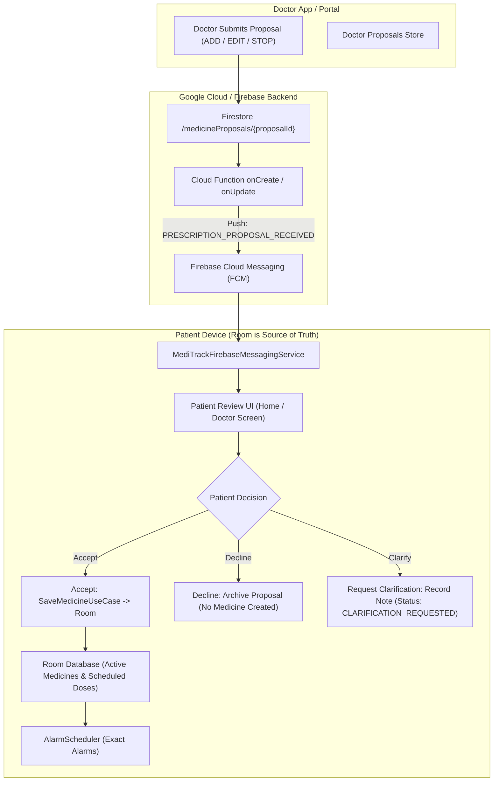

# Stage 10B Verification Pack – Doctor Mode

## 1. Architectural Architecture & Permissions (Section A)

### 1.1 Prescription Proposal Flow Diagram

### 1.2 Core Principle: Why Doctors Write Proposals, Not Active Medicines

> **The doctor proposes, the patient decides, and MediTrack activates the medicine only after explicit patient acceptance.**

In MediTrack, the patient retains full ownership and sovereignty over their medication regimen:
- Doctors **never** write directly to the `medicines` or `dose_events` tables.
- A prescription proposal remains inert until the patient explicitly reviews, consents, and taps **Accept**.
- If a proposal is declined, zero records are added to active medicines or scheduled doses.
- If a doctor revises an accepted prescription, it creates a new revision (`revision + 1`) with status `PENDING`, requiring fresh patient acceptance. An existing prescription is never silently overwritten.

### 1.3 Role Permissions Matrix

| Capability | Patient | Caregiver | Doctor |
|---|:---:|:---:|:---:|
| Add / Edit / Delete Owned Medicines | **Yes** (Full) | No (Read-Only) | No (Proposals Only) |
| Take Dose with Live Camera Verification | **Yes** | No | No |
| Bypass Photo Verification for Any Dose | **No** | **No** | **No** |
| Alter Stock or Historical Doses | **Yes** (Refill) | No | No |
| View Doses, Adherence, and Proof Photos | **Yes** | **Yes** (Linked Only) | **Yes** (Linked Only) |
| Create Prescription Proposals (`ADD`, `EDIT`, `STOP`) | No | No | **Yes** (Accepted Only) |
| Accept, Decline, or Revoke Connection Links | **Yes** | No | No |

### 1.4 Unverified Doctor Identity Policy
> **Explicit Notice:** MediTrack does **not** verify the medical qualification, licence number, registration certificate, or licensing status of a doctor. Selecting the Doctor role only identifies the user's app role. The patient is responsible for independently choosing a qualified healthcare professional. A Doctor account does not automatically grant access to any patient's health information.

---

## 2. Automated Test Results (Section B)

All automated unit tests pass 100% in local test suite (`238 tests, 0 failures`):

| Test Suite | Test Method | Requirement Verified | Result |
|---|---|---|:---:|
| `ProposalStateMachineTest` | `pending_canTransitionToAccepted` | `PENDING -> ACCEPTED` transition is legal | PASSED |
| `ProposalStateMachineTest` | `pending_canTransitionToDeclined` | `PENDING -> DECLINED` transition is legal | PASSED |
| `ProposalStateMachineTest` | `pending_canTransitionToClarificationRequested` | `PENDING -> CLARIFICATION_REQUESTED` transition is legal | PASSED |
| `ProposalStateMachineTest` | `pending_canTransitionToSuperseded` | `PENDING -> SUPERSEDED` transition is legal | PASSED |
| `ProposalStateMachineTest` | `clarificationRequested_canTransitionToAcceptedDeclinedOrSuperseded` | `CLARIFICATION_REQUESTED` legal exit transitions | PASSED |
| `ProposalStateMachineTest` | `accepted_canTransitionToSupersededOnRevision` | `ACCEPTED -> SUPERSEDED` upon doctor revision | PASSED |
| `ProposalStateMachineTest` | `declined_cannotTransitionToAccepted` | Terminal `DECLINED` cannot transition to `ACCEPTED` | PASSED |
| `ProposalStateMachineTest` | `superseded_cannotTransitionToPending` | Terminal `SUPERSEDED` cannot transition to `PENDING` | PASSED |
| `ProposalStateMachineTest` | `accepted_cannotTransitionDirectlyToDeclined` | Illegal transition from `ACCEPTED` to `DECLINED` throws `IllegalStateException` | PASSED |
| `PrescriptionProposalWorkflowTest` | `acceptAddProposal_createsMedicineAndFutureDoses_andMarksAccepted` | Accepted `ADD` creates medicine, 7-day rolling doses, and alarms | PASSED |
| `PrescriptionProposalWorkflowTest` | `acceptEditProposal_updatesMedicine_affectsFutureDosesOnly` | Accepted `EDIT` modifies future doses only; past history untouched | PASSED |
| `PrescriptionProposalWorkflowTest` | `acceptStopProposal_stopsMedicine_deletesFuturePendingDoses_preservesHistory` | Accepted `STOP` cancels future pending doses and preserves past doses | PASSED |
| `PrescriptionProposalWorkflowTest` | `declineProposal_marksDeclined_createsNothing` | Declined proposal creates no medicines, doses, or alarms | PASSED |
| `PrescriptionProposalWorkflowTest` | `requestClarification_updatesStatusAndRecordsNote` | Clarification updates status and records note without touching medicines | PASSED |
| `PrescriptionProposalWorkflowTest` | `reviseProposal_supersedesOldProposal_createsNewRevision` | Revisions increment revision counter and require fresh patient review | PASSED |
| `DoctorAccessGatingTest` | `pendingLink_grantsZeroAccessToPatientData` | `PENDING` link denies doctor access to patient medicines/doses | PASSED |
| `DoctorAccessGatingTest` | `declinedLink_grantsZeroAccessToPatientData` | `DECLINED` link denies doctor access to patient medicines/doses | PASSED |
| `DoctorAccessGatingTest` | `revokedLink_immediatelyTerminatesDoctorAccess` | `REVOKED` link immediately terminates doctor access | PASSED |
| `DoctorAccessGatingTest` | `acceptedLink_grantsReadOnlyAccessToPatientData` | `ACCEPTED` link permits read-only monitoring | PASSED |
| `DoctorPrescriptionBypassTest` | `doctorPrescribedDose_cannotBypassPhotoVerificationToBecomeTaken` | Doctor-prescribed doses cannot become `TAKEN` without live photo verification | PASSED |
| `DoctorPrescriptionBypassTest` | `doctorPrescribedDose_illegalTransitionsAreBlocked` | Attempting bypass transitions from `MISSED` or `SKIPPED` fails | PASSED |
| `NotificationTextTest` | `doctorInviteReceived_producesExactSpecifiedText` | Push text: `"<name> wants to connect as your doctor on MediTrack. Review the request."` | PASSED |
| `NotificationTextTest` | `doctorInviteAccepted_producesExactSpecifiedText` | Push text: `"<patientName> accepted your doctor connection."` | PASSED |
| `NotificationTextTest` | `doctorInviteDeclined_producesExactSpecifiedText` | Push text: `"<patientName> declined your doctor connection."` | PASSED |
| `NotificationTextTest` | `doctorInviteRevoked_producesExactSpecifiedText` | Push text: `"Doctor access has been revoked."` | PASSED |
| `NotificationTextTest` | `prescriptionProposalReceived_producesExactSpecifiedText` | Push text: `"Dr <name> proposed a prescription for <Medicine>. Review and accept."` | PASSED |
| `NotificationTextTest` | `prescriptionAccepted_producesExactSpecifiedText` | Push text: `"<patientName> accepted the prescription proposal for <Medicine>."` | PASSED |
| `NotificationTextTest` | `prescriptionDeclined_producesExactSpecifiedText` | Push text: `"<patientName> declined the prescription proposal for <Medicine>."` | PASSED |
| `NotificationTextTest` | `prescriptionClarificationRequested_producesExactSpecifiedText` | Push text: `"<patientName> requested clarification on <Medicine>."` | PASSED |
| `NotificationTextTest` | `prescriptionRevised_producesExactSpecifiedText` | Push text: `"Dr <name> updated the prescription proposal for <Medicine>. Review the new revision."` | PASSED |
| `DoctorViewModelTest` | `generateDoctorInvite_createsFormattedCode` | Doctor generates formatted `DOC-xxxx` invite code | PASSED |
| `DoctorViewModelTest` | `patientConnectWithCode_createsPendingDoctorLink_andEnqueuesOutbox` | Connecting with code enqueues `DOCTOR_INVITE_RECEIVED` | PASSED |
| `DoctorViewModelTest` | `acceptDoctorConnection_setsAcceptedStatus_andEnqueuesOutbox` | Accepting enqueues `DOCTOR_INVITE_ACCEPTED` | PASSED |
| `DoctorViewModelTest` | `declineDoctorConnection_setsDeclinedStatus_andEnqueuesOutbox` | Declining enqueues `DOCTOR_INVITE_DECLINED` | PASSED |
| `DoctorViewModelTest` | `revokeDoctorAccess_setsRevokedStatus_andEnqueuesOutbox` | Revoking terminates access and enqueues `DOCTOR_INVITE_REVOKED` | PASSED |
| `DoctorViewModelTest` | `selectPatient_loadsMedicinesDosesAndAdherenceReadOnly` | Read-only patient data loading and adherence calculation | PASSED |
| `DoctorViewModelTest` | `createPrescriptionProposal_createsPendingProposal_andEnqueuesOutbox` | Creates proposal and enqueues `PRESCRIPTION_PROPOSAL_RECEIVED` | PASSED |

---

## 3. Two-Account Interactive Walkthrough (Section C)

### Step 1: Doctor Generates Invitation
1. In top app bar of Doctor Screen, switch role to **Doctor**.
2. Tap **"Generate Invitation Code"** $\rightarrow$ code appears: e.g. `DOC-4821`.

### Step 2: Patient Connects & Consents
1. Switch role to **Patient** (or log in on patient device).
2. Go to **Doctor Connection** section $\rightarrow$ enter `DOC-4821` $\rightarrow$ tap **Connect**.
3. Under "Doctor Connections", the request appears with status `PENDING`.
4. Tap **Accept** $\rightarrow$ status updates to `ACCEPTED` (`"Doctor connected: Dr. Smith"`).
*(Note: If patient taps **Decline**, status updates to `DECLINED` and doctor receives zero access).*

### Step 3: Doctor Submits Proposal
1. Switch to **Doctor** view $\rightarrow$ Patient appears under **"Connected Patients"**.
2. Tap **View** $\rightarrow$ Tap **"Propose Prescription"**.
3. Enter Medicine Name: `"Amoxicillin"`, Dosage: `"500mg"`, Time: `"08:00"`, Instructions: `"Take with water"`.
4. Tap **Submit Proposal** $\rightarrow$ proposal is submitted in `PENDING` state.

### Step 4: Patient Clarification & Doctor Revision
1. Switch to **Patient** view $\rightarrow$ Proposal card is visible under "Prescription Proposals".
2. Tap **Ask Note** $\rightarrow$ enter `"Should I take this with food?"` $\rightarrow$ status updates to `CLARIFICATION_REQUESTED`.
3. Switch to Doctor view $\rightarrow$ Doctor reviews note and taps revise $\rightarrow$ creates Revision 2 with updated instructions.

### Step 5: Patient Accepts $\rightarrow$ Activation
1. Switch to Patient view $\rightarrow$ Tap **Accept** on Revision 2:
   - Medicine is activated in Room.
   - Future 7-day dose schedule is generated.
   - Exact alarms are scheduled.
   - Proposal transitions to `ACCEPTED`.
2. Home screen now displays the prescribed medicine with `"Prescribed by Dr. Smith"`.

### Step 6: Patient Revocation
1. At any time, patient taps **Revoke Access** on the connected doctor card.
2. Link immediately updates to `REVOKED`.
3. In Doctor view: Patient disappears from connected patients list. Any attempt to query patient data receives zero access.

---

## 4. Security Rules Specification (Section D)

The security rules in [`firestore.rules`](file:///c:/Users/bharg/OneDrive/Documents/Desktop/MedTracker%20-%20BioDesign/firestore.rules) and [`storage.rules`](file:///c:/Users/bharg/OneDrive/Documents/Desktop/MedTracker%20-%20BioDesign/storage.rules) enforce:
1. **Zero Access for Pending, Declined, or Revoked Doctors**:
   - `isAcceptedDoctor(userId)` requires `doctorLinks/{patientId_doctorUid}.status == 'ACCEPTED'`.
   - If status is `PENDING`, `DECLINED`, or `REVOKED`, read access is denied.
2. **Proposals Sandbox**:
   - Doctors can only create documents in `medicineProposals` (never in `medicines` or `doseEvents`).
   - Creation is allowed only if `isAcceptedDoctor(patientUid)` returns true.
3. **Strict Proof Photos Access**:
   - Only the patient owner, accepted caregiver, or accepted doctor can read photos.
   - Only the patient owner can upload photos (`isOwner(patientUid)`). Doctors and caregivers have zero upload/delete permissions.

---

## 5. Documented Limitations (Section E)

In compliance with the specification in `README.md`:
1. **No License or Credential Verification**: MediTrack does not verify medical licences, registration numbers, or credentials.
2. **No Chat System**: Communication occurs strictly via structured prescription proposal statuses and recorded clarification notes.
3. **No Legal e-Prescribing**: MediTrack does not provide legal e-prescribing or pharmacy dispensing integrations. All prescriptions require explicit patient acceptance and intake verification.
