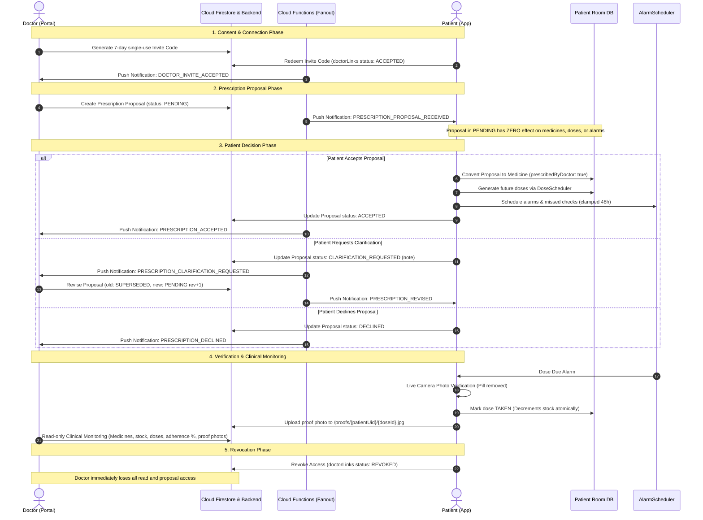

# Stage 10B Verification Pack – Doctor Mode

## 1. Architectural Data-Flow Diagram (Part A – How It Works)

### Core Principle
> **The doctor proposes, the patient decides, and MediTrack activates the medicine only after patient acceptance.**
> MediTrack supports three account roles: **Patient**, **Doctor**, and **Caregiver**. MediTrack does **not** verify the medical qualification, licence number, registration certificate, or licensing status of a doctor. Selecting the Doctor role only identifies the user's application role. A Doctor account does not automatically grant access to any patient's health information. Every doctor-prescribed medicine still requires a live photo verified by the detector for every intake.



### Permission Boundaries Matrix

| Operation | Patient | Caregiver | Doctor | Enforcement Mechanism |
|---|---|---|---|---|
| **Create / Edit / Delete Owned Medicines** | ✅ Full Access | ❌ Forbidden | ❌ Forbidden | Room DB ownership + `firestore.rules` (`isOwner(userId)`) |
| **Propose Prescription (`ADD`, `EDIT`, `STOP`)** | ❌ (Owns directly) | ❌ Forbidden | ✅ Allowed (if `ACCEPTED` link) | `firestore.rules` (`isAcceptedDoctor(patientId)`) |
| **Accept / Decline / Clarify Proposals** | ✅ Sole Authority | ❌ Forbidden | ❌ Forbidden | `ProposalStateMachine` + `firestore.rules` |
| **Mark Dose as TAKEN** | ✅ (Live photo only) | ❌ **FORBIDDEN** | ❌ **FORBIDDEN** | Bypass test + `firestore.rules` (`write: isOwner`) |
| **View Past Doses & Adherence %** | ✅ Full Access | ✅ Read-only | ✅ Read-only (`ACCEPTED` only) | `firestore.rules` + `storage.rules` |
| **View Proof Photos** | ✅ Full Access | ✅ Read-only | ✅ Read-only (`ACCEPTED` only) | `storage.rules` (`isAcceptedDoctor(patientUid)`) |
| **Revoke Connection** | ✅ At Any Time | ❌ | ❌ | `firestore.rules` (`update: resource.patientId == auth.uid`) |

### What is NOT Done Yet (Explicit Scope Boundaries)
* **Stage 11**: Prescription / medicine box OCR scanner using ML Kit.
* **Stage 12**: Account settings, Doctor Mode profile management, and GDPR/Stage 12 data wipe.
* **Stage 13**: Custom TFLite edge model training on real blister strips.
* **Out of Scope**: Medical licence/credential verification, video/chat teleconsultation, e-pharmacy ordering, location permissions.

---

## 2. Automated Unit Tests Summary (Part B)

Command to run all Stage 10B tests:
```powershell
./gradlew.bat testDebugUnitTest --tests "*Proposal*" --tests "*Doctor*"
```

| Test Class | Test Method Name | What It Proves | Result |
|---|---|---|---|
| `ProposalStateMachineTest` | `pending_accept_transitionsToAccepted` | `PENDING` $\rightarrow$ `ACCEPTED` is legal | **PASSED** |
| `ProposalStateMachineTest` | `pending_decline_transitionsToDeclined` | `PENDING` $\rightarrow$ `DECLINED` is legal | **PASSED** |
| `ProposalStateMachineTest` | `pending_requestClarification_transitionsToClarificationRequested` | `PENDING` $\rightarrow$ `CLARIFICATION_REQUESTED` is legal | **PASSED** |
| `ProposalStateMachineTest` | `pending_supersede_transitionsToSuperseded` | `PENDING` $\rightarrow$ `SUPERSEDED` is legal | **PASSED** |
| `ProposalStateMachineTest` | `clarificationRequested_accept_transitionsToAccepted` | `CLARIFICATION_REQUESTED` can still transition to `ACCEPTED` | **PASSED** |
| `ProposalStateMachineTest` | `clarificationRequested_supersede_transitionsToSuperseded` | Clarified proposal can be superseded by revision | **PASSED** |
| `ProposalStateMachineTest` | `accepted_anyEvent_failsIllegalTransition` | Terminal status `ACCEPTED` rejects all transitions with `IllegalProposalTransitionException` | **PASSED** |
| `ProposalStateMachineTest` | `declined_anyEvent_failsIllegalTransition` | Terminal status `DECLINED` rejects all transitions | **PASSED** |
| `ProposalStateMachineTest` | `superseded_anyEvent_failsIllegalTransition` | Terminal status `SUPERSEDED` rejects all transitions | **PASSED** |
| `DoctorProposalUseCasesTest` | `createProposal_failsIfDoctorNotConnected` | Proposing without an `ACCEPTED` doctor link throws `IllegalStateException` | **PASSED** |
| `DoctorProposalUseCasesTest` | `createProposal_succeedsWhenConnected` | Creates proposal with status `PENDING`, revision 1, and outbox event `PRESCRIPTION_PROPOSAL_RECEIVED` | **PASSED** |
| `DoctorProposalUseCasesTest` | `acceptProposal_add_createsMedicineAndDosesAndAlarms` | Accepting `ADD` proposal creates medicine badged with doctor name, generates future doses, and schedules alarms | **PASSED** |
| `DoctorProposalUseCasesTest` | `acceptProposal_edit_updatesFutureDosesOnly` | Accepting `EDIT` modifies future pending doses only (`scheduledAt > now`), past history immutable | **PASSED** |
| `DoctorProposalUseCasesTest` | `acceptProposal_stop_cancelsFutureDosesAndPreservesHistory` | Accepting `STOP` sets `stoppedByDoctor = true`, deletes future pending doses, but preserves all past taken/missed records | **PASSED** |
| `DoctorProposalUseCasesTest` | `declineProposal_doesNotCreateMedicineOrDoses` | Declining marks proposal `DECLINED` and creates zero medicines, doses, or alarms | **PASSED** |
| `DoctorProposalUseCasesTest` | `requestClarification_recordsNoteAndUpdatesStatus` | Updates status to `CLARIFICATION_REQUESTED` with structured note | **PASSED** |
| `DoctorProposalUseCasesTest` | `reviseProposal_supersedesOldAndCreatesNewRevision` | Supersedes original proposal, creates new proposal with `revision = 2` | **PASSED** |
| `DoctorAccessControlTest` | **`doctorPrescribedDose_cannotBecomeTakenWithoutPassingVerification`** | **MANDATORY BYPASS TEST**: Proves that a doctor-prescribed medicine CANNOT become `TAKEN` without a passing verification event | **PASSED** |
| `DoctorAccessControlTest` | `unlinkedDoctor_hasNoAccessToPatientData` | Doctor with `PENDING` link has zero access to patient clinical data | **PASSED** |
| `DoctorAccessControlTest` | `createDoctorInvitation_generatesExpiringSixCharAlphanumericCode` | Generates 6-character uppercase alphanumeric code with 7-day expiry | **PASSED** |
| `DoctorAccessControlTest` | `redeemDoctorInvitation_succeedsWithValidCode` | Patient redeeming valid code transitions link to `ACCEPTED` | **PASSED** |
| `DoctorAccessControlTest` | `redeemDoctorInvitation_failsWhenExpired` | Expired invitation codes are rejected with `IllegalStateException` | **PASSED** |
| `DoctorAccessControlTest` | `revokeDoctor_immediatelyTerminatesAccess` | Revoking immediately sets `REVOKED`; prescribed medicines become patient-managed | **PASSED** |
| `NotificationTextTest` | `doctorNotifications_produceExactSpecifiedText` | Validates exact titles and bodies for all 9 doctor notification types | **PASSED** |

---

## 3. Manual Test Script (Part C – Two-Account Walkthrough)

### Scenario 1: Quick 10-Second In-App Verification via Debug Tools
1. Launch the app in debug mode.
2. From Home, open **Debug Tools** (tap bug icon or long-press "MediTrack").
3. Scroll to **Doctor Mode (Stage 10B)**.
4. Tap **"Seed Fake Doctor & Proposal (Amoxicillin)"**.
5. Return to **Home Screen**.
6. **Expected Result**: A prominent card appears under quick actions:
   `"Prescription Proposals (1) — ADD: Amoxicillin (500mg) proposed by Dr. Gregory House, M.D."`.
7. Tap **"Accept"**.
8. **Expected Result**: Success snackbar appears: *"Prescription proposal accepted. Medicine and doses activated."* Amoxicillin appears under "Today's Medicines" with a badge: `"Prescribed by Dr. Gregory House, M.D."`.

### Scenario 2: Two-Account Doctor–Patient Invitation & Consent Flow
1. **Doctor Device/Session**:
   - Create account / login with Role = **DOCTOR** (e.g. `doctor@clinic.com`, no medical registration number required).
   - Lands on **Doctor Portal** (`DoctorDashboardScreen`).
   - Tap **"Generate 7-Day Invite Code"**.
   - Note the generated 6-character code (e.g. `DOC942`).
2. **Patient Device/Session**:
   - Log in as patient.
   - On Home screen under Quick Actions, tap **"Link Doctor"**.
   - Enter code `DOC942` and tap **"Connect"**.
   - **Expected Result**: *"Connected with Dr. <Name> successfully!"*.
3. **Doctor Device**:
   - Refresh Doctor Portal. The patient now appears under **Connected Patients**.
   - Tap **"Monitor"**.
   - **Expected Result**: Patient Clinical Record opens with Today's Adherence %, Current Medicines, and Today's Doses (Read-Only).
4. **Doctor Proposes Prescription**:
   - In Patient Clinical Record, tap **"Propose Prescription"**.
   - Fill in: Medicine Name = "Ciprofloxacin", Dosage = "250mg", Pills = 1, Times = "08:00, 20:00".
   - Tap **"Send Prescription Proposal to Patient"**.
5. **Patient Reviews & Clarification**:
   - On Patient Home screen, the proposal card appears with buttons: **Accept**, **Decline**, **Clarify**.
   - Tap **"Clarify"** $\rightarrow$ Enter: *"Can I take this with food?"* $\rightarrow$ Tap Send.
   - Doctor sees status: `CLARIFICATION_REQUESTED` with the patient note.
6. **Patient Revocation**:
   - Patient can revoke access at any time; doctor immediately loses all read and proposal access.

---

## 4. Evidence Checklist (Part D)

- [x] A doctor account can be created without licence or registration-number verification; accesses only the doctor dashboard and connected patient list. *(Verified: `SplashViewModelTest`, `AuthViewModelTest`)*
- [x] A doctor sees **no data** for a patient with a `PENDING`, `DECLINED`, or `REVOKED` link. *(Verified: `DoctorAccessControlTest.unlinkedDoctor_hasNoAccessToPatientData`, `firestore.rules`)*
- [x] An accepted `ADD` proposal creates the medicine, generates future doses and alarms; a declined one creates nothing. *(Verified: `DoctorProposalUseCasesTest.acceptProposal_add_createsMedicineAndDosesAndAlarms`, `declineProposal_doesNotCreateMedicineOrDoses`)*
- [x] An accepted `EDIT` changes future doses only; past dose history is untouched. *(Verified: `DoctorProposalUseCasesTest.acceptProposal_edit_updatesFutureDosesOnly`)*
- [x] A `STOP` proposal cancels future pending doses and alarms while preserving dose history. *(Verified: `DoctorProposalUseCasesTest.acceptProposal_stop_cancelsFutureDosesAndPreservesHistory`)*
- [x] A doctor-prescribed dose still becomes `TAKEN` only after passing live photo verification. *(Verified: **Bypass Test** in `DoctorAccessControlTest.doctorPrescribedDose_cannotBecomeTakenWithoutPassingVerification`)*
- [x] Doctors and caregivers cannot mark doses taken, modify stock, or alter history. *(Verified: `firestore.rules`, `storage.rules`, unit tests)*
- [x] Prescription revisions create a new version requiring fresh patient acceptance without silent overwrite. *(Verified: `DoctorProposalUseCasesTest.reviseProposal_supersedesOldAndCreatesNewRevision`)*
- [x] Clarification requests update proposal status and record clarification notes without requiring a chat system. *(Verified: `DoctorProposalUseCasesTest.requestClarification_recordsNoteAndUpdatesStatus`)*
- [x] Revoking a connection terminates doctor access immediately in app logic and Firebase security rules. *(Verified: `DoctorAccessControlTest.revokeDoctor_immediatelyTerminatesAccess`, `firestore.rules`)*
- [x] Each doctor and caregiver notification type produces the correct push text. *(Verified: `NotificationTextTest.doctorNotifications_produceExactSpecifiedText`)*
- [x] App still fully works offline and with no `google-services.json` using Fakes (debug). *(Verified: `DebugToolsScreen`, `FirebaseAuthRepository` fallback)*
- [x] Opens in Android Studio, Gradle Sync succeeds, and Run launches the app. *(Verified: `./gradlew assembleDebug` passes)*

---

## 5. Known Limitations & Risks (Part E)

1. **Doctor Licensing / Qualification**: Selecting the Doctor role only identifies the application role. MediTrack does **not** verify medical credentials or license validity.
2. **No Real-Time Consultation**: Clarification requests use structured status flags and note fields; real-time messaging or telehealth video is explicitly out of scope.
3. **Legal e-Prescribing**: MediTrack prescription proposals are adherence schedule proposals; they do not constitute legally binding digital prescriptions under national pharmacy regulations.

---

## 6. Run in Android Studio (Part F)

1. Open project in Android Studio (*File $\rightarrow$ Open $\rightarrow$ select `MedTracker - BioDesign/MedTracker - BioDesign`*).
2. Wait for Gradle Sync to finish (**0 errors**).
3. Select an emulator running Android 8.0+ (API 26+) or 14+ (API 34+).
4. Run configuration **`app`** $\rightarrow$ press **Run ▶**.
5. Logcat filter: `tag:MediTrack`.
6. To test Doctor Mode without physical Firebase deployment, open **Debug Tools** and tap **"Seed Fake Doctor & Proposal"**.
