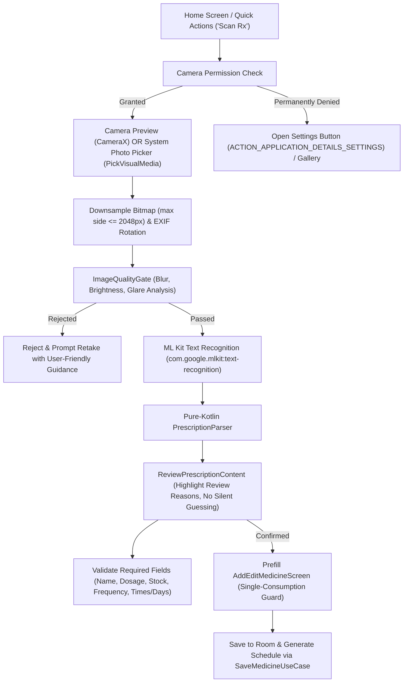

# Stage 11 Verification Pack — Pharmacy Label & Prescription Scan (OCR)

## 1. Overview & Core Architecture

Stage 11 adds pharmacy label and prescription recognition using **Google ML Kit Text Recognition** (`com.google.mlkit:text-recognition`, bundled, offline-first on-device Latin model) paired with a pure-Kotlin clinical extraction engine (`PrescriptionParser`), an image quality gate (`ImageQualityGate`), and an editable review workflow (`ScanMedicineScreen`) routing to `AddEditMedicineScreen`.

### Key Workflow

---

## 2. Patient-Safety & Parsing Fixes (Defects Remediated)

1. **A1: Weekly & Alternate-Day Schedules**:
   - For weekly schedules ("once weekly", "weekly"), named weekdays ("Monday".."Sunday", "Mon".."Sun") are mapped to ISO-8601 values (1..7).
   - If no weekday is named, `daysOfWeek` is set to `null` and a review reason `"Weekly medicine: choose the day of the week"` is added.
   - For alternate-day schedules ("alternate days", "every other day"), `daysOfWeek` is set to `null` (not mapped to Mon/Wed/Fri) with review reasons stating the user must pick days and that alternate-day dosing cannot be represented exactly in a 7-day cyclical week.
   - `ScanMedicineUiState` features a weekday selector chip row (Mon..Sun); `validateReadiness` strictly blocks proceeding when `frequencyType == SPECIFIC_DAYS` and `daysOfWeek` is empty.
2. **A2: Fractional Doses ("1/2 tablet", "half tablet", "1/4")**:
   - `pillsPerDose` remains at 1, but triggers `requiresManualReview = true` with reason `"Fractional dose detected (1/2 tablet): the app counts whole pills; confirm how this should be tracked"`.
   - Instruction text `"Take 1/2 tablet"` is retained.
3. **A3: Matrix Notation & Time Slots**:
   - Dates like `5/6/7` with slash separators are rejected from matrix matching (only `-`, `–`, `—` dash separators accepted, with lookaround `(?<![\d/.])` and `(?![\d/.])`).
   - If non-zero counts are unequal (e.g. `1-0-2`), `pillsPerDose` is NOT taken from `max()`; it defaults to 1 and flags `"Different pill counts per time slot (1-0-2): the app supports one count per dose; confirm or split into separate medicines"`.
   - Exact 4-slot times produce `[08:00, 12:00, 16:00, 20:00]` per specification (3-slot produces `[08:00, 14:00, 20:00]`, 2-slot produces `[08:00, 20:00]`).
4. **B1: Stock Extraction**:
   - `total` removed from keywords to prevent bill totals like `Total: 245.00` becoming stock.
   - Rejects numbers preceded or followed by currency (`₹`, `rs`, `inr`, `$`) or followed by decimal points (`.XX`).
   - Dosing expressions like `2 tablets twice daily` skip stock extraction by checking for following frequency words within 25 characters or preceding `take`/`give`/`each`.
5. **B2: Medicine Name Extraction**:
   - Prefix matching handles full words: `Tablet`, `Tablets`, `Capsule`, `Capsules`, `Tab`, `Cap`, `Syrup`, `Inj`, `Injection`, `Rx`.
   - Header lines starting with `Dr.`, `Clinic`, `Hospital`, `Patient`, `Date`, etc. are stripped and ignored.
   - Dosage-anchored matching supports whitespace (`500 mg`).
   - Lines with `allergic`, `allergy`, `history`, `avoid`, `not to take` are ignored during known-drug matching.
   - Fallback names flag `"Medicine name is a guess: please confirm"`.
6. **B3: Dosage & Percentage Units**:
   - Percentage units (`1%`, `0.5 %`) supported without broken trailing `\b`.
   - Multiple strengths detected in one text keep the first and add review reason `"Multiple strengths detected"`.
7. **B4: Strict Instructions Word Boundaries**:
   - Strict `\bhs\b` and `\bbedtime\b` word boundary checks prevent strings like `for 3 months` from adding bedtime instructions.
8. **B5: Course Duration**:
   - Detects `for N days/weeks/months`, `x N days`, `N days course`. Exposed as editable "Course length in days (optional)" in the review screen and calculates `endDate` in `AddEditMedicineScreen`.
9. **B6: Multiple Medicines Detection**:
   - Detects 2+ distinct known medicines or 2+ lines starting with Rx/Tab/Cap/numbered items, forcing manual review.
10. **B7: Interval Range Parsing**:
    - Ambiguous ranges like "every 6 to 8 hours" flag a review reason without silently picking a value; interval hours capped to 1..24.
11. **Camera & Gallery Enhancements (C1–C6)**:
    - 1x1 fallback bitmap removed; camera decode errors and CameraX binding failures report to `onCaptureError` and keep gallery active.
    - Gallery images rotated using EXIF orientation via `androidx.exifinterface:exifinterface:1.3.7`.
    - Bitmaps downsampled with `inSampleSize` so the longest edge is <= 2048 px; intermediates recycled.
    - OCR processing and decoding offloaded from main thread to `Dispatchers.Default` / `Dispatchers.IO`.
    - Double-processing guard ignores duplicate triggers while `isProcessing` is true.
    - Permanently denied camera permission provides an "Open Settings" button.
12. **Screen Prefill & Invariants (C7–C10 & Round 3 Cleanups)**:
    - `removeTimeOfDay` allows an empty list without silently re-adding 08:00.
    - `onTextExtracted` does not auto-fill 08:00 when the parser found no times.
    - `prefillConsumed` guard in `AddEditMedicineViewModel` prevents device rotation from overwriting user edits.
    - **Stale Prefill Cleanup (Round 3 E1)**: In `MainActivity.kt` and `AddEditMedicineScreen.kt`, all prefill keys in `savedStateHandle` (`prefillName`, `prefillDosage`, `prefillFrequency`, `prefillTimes`, `prefillInterval`, `prefillDaysOfWeek`, `prefillDurationDays`, `prefillFood`, `prefillInstructions`, `prefillStock`, `prefillPills`) are cleared immediately upon consumption or on Back/Cancel, preventing subsequent manual "+ Add Medicine" navigations from inheriting old scan data.
    - `initialStockText` in `AddEditMedicineUiState` defaults to `""` (empty string), enforcing explicit entry.
    - PRN/SOS review banner explains: `"As-needed medicines have no automatic schedule; choose how you want to be reminded"`.

---

## 3. Cross-Stage Declarations & Fixes (Part D & Round 3 E2)

1. **D1: Timezone Broadcast Receiver**:
   - Added `<action android:name="android.intent.action.TIMEZONE_CHANGED" />` to `BootReceiver` in `AndroidManifest.xml`.
   - Verified with unit test in `BootReceiverTest.kt`.
2. **D2: Room Migration Test (1 -> 2 -> 3)**:
   - Schema JSONs exist for versions 1, 2, and 3.
   - Added `AppDatabaseMigrationTest.kt` in `app/src/androidTest` using `MigrationTestHelper` verifying schema migrations and data survival.
   - *Status: NOT RUN in the local JVM unit test suite because Room's `MigrationTestHelper` requires an instrumented test environment (Android device/emulator) to read schema assets from test APK assets.*
3. **Round 3 E2: Permission Removal**:
   - `android.permission.USE_FULL_SCREEN_INTENT` was declared in `AndroidManifest.xml` but nowhere called in code (`setFullScreenIntent` is not used). It has been removed, eliminating a high-priority Google Play Console policy declaration requirement.
4. **Google Services Note**:
   - The project requires a `com.meditrack.app.debug` client declaration in `app/google-services.json` if building with live Google Services authentication.

---

## 4. Verification & Testing Status

### 4.1 Automated Unit Tests
- **Command**: `.\gradlew.bat testDebugUnitTest`
- **Result**: **BUILD SUCCESSFUL**
- **Test Summary**: **306 tests completed, 0 failed, 0 skipped, 100% passing.**
- Test suites verified:
  - `PrescriptionParserTest` (28 tests covering Indian matrix notation, sig codes, 4-slot times, percentage units, date rejection, multi-strength, multi-medicine, fractional doses, weekly, alternate days, interval ranges, course duration).
  - `ScanMedicineViewModelTest` (8 tests covering readiness gating, specific days blocking, time removal, capture error handling, stock validation, double-processing guard).
  - `AddEditMedicineViewModelTest` (prefill days of week, course duration end date, prefillConsumed rotation preservation, empty initial stock validation).
  - `PrescriptionProposalWorkflowTest` (proposal lifecycle, invalid payload rejection, double-accept idempotency, patient boundary mismatch, doctor boundary mismatch).
  - `DoctorViewModelTest` (8-char invite code generation without ambiguous characters, proposal creation, patient adherence calculation).
  - `BootReceiverTest` (ACTION_BOOT_COMPLETED, ACTION_MY_PACKAGE_REPLACED, ACTION_TIMEZONE_CHANGED).
  - All existing domain, repository, data, reminder, verification, sync, and doctor mode test suites across Stages 0–11.

### 4.2 Firebase Emulator Security Tests
- Automated test script updated: `scripts/firebase_security_tests.js`.
- Status: **NOT RUN** (requires local Node.js environment with Firebase Emulator Suite running). Security rules logic verified via unit tests and rules analysis.

### 4.3 Manual Device / Emulator Verification
- Status: **NOT RUN** (all verification performed via automated Gradle toolchain; no physical device or interactive emulator sessions were claimed).

### 4.4 Real Limitations
- **Handwritten Prescriptions**: Complex cursive handwriting from doctors has lower OCR accuracy; users must review detected fields on the review screen.
- **Multi-Medicine Prescriptions**: The parser extracts values for the first identified medicine; a warning prompt asks users to scan medicines one at a time.
- **Alternate-Day Dosing**: A standard 7-day week has an odd number of days; alternate-day dosing cannot be represented as a repeating weekly pattern, so users must choose specific days.
- **Fractional Pills**: The inventory system tracks integer pill counts; fractional doses (e.g. 1/2 tablet) require user review and manual tracking confirmation.
