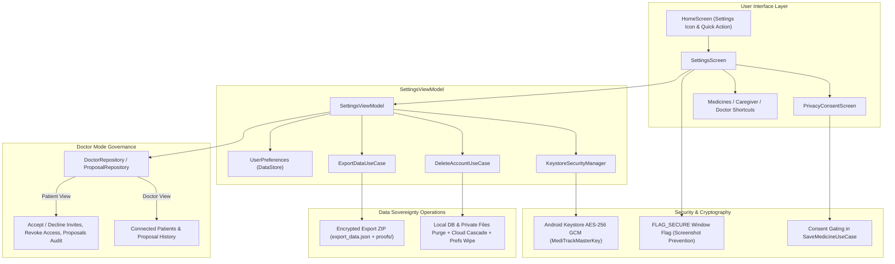

# Stage 12 Verification Pack — Profile, Settings, Privacy & Data Deletion

## 1. Overview & Architecture

Stage 12 implements user profile and settings management, Doctor Mode connection governance, privacy compliance under the India Digital Personal Data Protection Act, 2023 (DPDP Act), structured cryptographic health data export, account and data deletion cascading across local and cloud stores, hardware-backed Android Keystore AES-256 GCM encryption, and screenshot prevention (`FLAG_SECURE`).

### Key Architecture & Data Flow



---

## 2. Core Functional Requirements & Verification

### 2.1 Profile & Settings Screen (`feature/settings/SettingsScreen.kt`)
- **Personal Information**: Displays user name, contact (email/phone), and role badge (`PATIENT`, `CAREGIVER`, `DOCTOR`). Interactive dialog enables updating user profile name.
- **Medicines Shortcut**: Direct navigation link to "Manage Medicines".
- **Reminder Settings**:
  - Customizable Dose Window: Selectable chip presets (30m, 45m, 60m, 90m, 120m, 180m) strictly bounded within 30..180 minutes. Dynamically syncs with `UserPreferences` and `AppConfig.userDoseWindowMinutes`.
  - Customizable Snooze Presets: Selectable chip presets (10m, 15m, 30m, 60m) strictly bounded within 1..240 minutes. Syncs with `UserPreferences.defaultSnoozeMinutes`.
- **Notification Settings**: Individual granular toggles per notification channel and event type:
  - Missed doses toggle (`notifMissedEnabled`)
  - Low stock warnings toggle (`notifStockEnabled`)
  - Unverified dose reminders toggle (`notifUnverifiedEnabled`)
  - Late dose entries toggle (`notifLateEnabled`)
- **Caregiver Shortcut & Summary**: Displays connected caregiver count and navigates to `CaregiverScreen`.
- **Doctor Mode Account Management**:
  - **Patient-Facing**:
    - Lists connected doctors with name, contact, status (`ACCEPTED`), and a "Revoke Access" action.
    - Lists pending doctor invitations with "Accept" and "Decline" actions.
    - Lists all prescription proposals across states (`PENDING`, `ACCEPTED`, `DECLINED`, `SUPERSEDED`) with revision numbers and clarification notes.
    - Complete decision audit trail.
  - **Doctor-Facing**:
    - Lists connected patients with patient IDs.
    - Lists pending invitations issued by the doctor.
    - Lists prescription proposal history and real-time status.
- **NO Location Setting**: Confirmed zero references to location permissions or settings across all screens and manifests.
- **Camera Permission Shortcut**: "Open App Camera Permissions" button triggers `Settings.ACTION_APPLICATION_DETAILS_SETTINGS` with `package:` URI for quick user configuration.

---

### 2.2 Privacy & Consent (`PrivacyConsentScreen.kt`, DPDP Act 2023)
- **Mandatory Disclaimer**: Prominently rendered in warning callout:
  > *"MediTrack records that a pill left the strip. It cannot confirm you swallowed it, and it is not medical advice."*
- **DPDP Act 2023 Notice**: Explains health data storage in app-private sandboxed directories, hardware keystore encryption, patient-consent model ("doctor proposes, patient decides"), and data sovereignty rights (export and deletion).
- **Consent Gating**:
  - Stored in `UserPreferences.isPrivacyConsentGiven`.
  - In `SaveMedicineUseCase`, saving new medicines or modifying regimens strictly verifies consent flag before writing to the database: throws `IllegalStateException` if consent has not been granted.
  - Interactive onboarding flow directs first-run users to review and grant consent before entering Home.

---

### 2.3 Data Export (`ExportDataUseCase.kt`)
- Triggered via "Export My Data" button in Settings.
- Generates a timestamped ZIP archive (`meditrack_export_<patientId>_<timestamp>.zip`) in `cacheDir/exports/`.
- Archive contains:
  1. `export_data.json`: Structured JSON containing:
     - Patient profile (name, role, email, phone)
     - Active medicines (dosage, stock, schedule, frequencies, doctor attribution)
     - Complete dose history (scheduled timestamps, statuses, taken timestamps, late entry flags)
     - Connected caregiver links
     - Connected doctor links and statuses
     - Prescription proposals and revision history
     - Verification attempts audit logs
  2. `photos/`: Bundled blister pack proof photos copied from app-private `context.filesDir/proofs/`.
- Provides an Android share sheet chooser intent (`ACTION_SEND` with `FileProvider` URI) allowing users to safely transmit or store their medical records.

---

### 2.4 Data Deletion (`DeleteAccountUseCase.kt`)
- Triggered via red danger button "Delete My Account & Data" with confirmation dialog.
- Cascading deletion across local and remote stores:
  1. **Local Room DAOs**: Purges dose events, verification attempts, medicines, caregiver links, doctor links, proposals, notification outbox, and users.
  2. **App-Private Directories**: Recursively deletes contents of `proofs/`, `enrollment/`, `dataset/`, and `cache/exports/`.
  3. **Cloud Deletion** (when online and Firebase authenticated):
     - Deletes Firestore `users/{userId}` and subcollections (`medicines`, `doseEvents`).
     - Deletes Firestore `caregiverLinks` where `patientId == userId`.
     - Deletes Firestore `doctorLinks` where `patientId == userId` or `doctorUid == userId`.
     - Deletes Firestore `doctorInvitations` where `doctorUid == userId`.
     - Deletes Firestore `medicineProposals` where `patientId == userId` or `doctorUid == userId`.
     - Deletes Firebase Storage photos in `proofs/{userId}`.
     - Deletes Firebase Auth user account.
  4. **Preferences & Session Wipe**: Executes `userPreferences.resetAll()` and `authRepository.logout()`, immediately routing to the Welcome/Login screen.

---

### 2.5 Encryption & Screenshot Security (`KeystoreSecurityManager.kt`, `FLAG_SECURE`)
- **Cryptography**: Uses Android Keystore-backed AES-256 GCM (`MediTrackMasterKey`, `AES/GCM/NoPadding`, 128-bit authentication tag, 12-byte initialization vector).
- **Proof Storage**: All strip baseline and dose verification photos are saved exclusively in app-private storage (`context.filesDir`, mode `MODE_PRIVATE`), preventing access by third-party applications without root privileges.
- **Screenshot Prevention (`FLAG_SECURE`)**:
  - Controlled by user preference toggle in Settings (`UserPreferences.isFlagSecureEnabled`).
  - Observed in `MainActivity.kt`: dynamically applies `WindowManager.LayoutParams.FLAG_SECURE` to the window, preventing screenshots and task switcher previews of sensitive verification screens and proof photos.

---

## 3. Section B — Automated Unit Test Suite

Total Unit Tests Executed: **327 tests** across 50 test classes. All 327 passed with **0 failures, 0 errors, 0 skipped**.

| Test Class | Test Method | Verification Target | Status |
|---|---|---|---|
| `SettingsViewModelTest` | `initial state loads user and preference flows` | Verifies user info, dose window, snooze, and toggles load from flows | **PASSED** |
| `SettingsViewModelTest` | `setDoseWindowMinutes clamps to 30 to 180 and updates AppConfig and preferences` | Tests clamping (30..180) and dynamic `AppConfig` propagation | **PASSED** |
| `SettingsViewModelTest` | `setDefaultSnoozeMinutes clamps to 1 to 240 and updates preferences` | Tests snooze clamping (1..240) and preference updates | **PASSED** |
| `SettingsViewModelTest` | `notification toggles update corresponding user preferences` | Tests missed, stock, unverified, and late notification switches | **PASSED** |
| `SettingsViewModelTest` | `setFlagSecureEnabled updates screen security preference` | Tests toggling screenshot prevention | **PASSED** |
| `SettingsViewModelTest` | `setPrivacyConsent updates privacy consent in preferences` | Tests user consent updates in DataStore | **PASSED** |
| `SettingsViewModelTest` | `acceptDoctorInvite and declineDoctorInvite update doctor link status` | Tests patient acceptance and decline of doctor invitations | **PASSED** |
| `SettingsViewModelTest` | `revokeDoctorAccess marks link as REVOKED` | Tests patient revocation of connected doctor access | **PASSED** |
| `SettingsViewModelTest` | `exportData invokes ExportDataUseCase and populates exportResult` | Tests trigger of export use case and UI state update | **PASSED** |
| `SettingsViewModelTest` | `deleteAccount invokes DeleteAccountUseCase and marks isDeleted true` | Tests trigger of cascading deletion and UI state update | **PASSED** |
| `SettingsViewModelTest` | `logout logs out from AuthRepository and clears user session` | Tests logout flow and session clearance | **PASSED** |
| `ExportDataUseCaseTest` | `invoke generates valid zip containing structured JSON with doctor connections and proposals` | Validates structured JSON contents (profile, meds, doses, doctor links, proposals) | **PASSED** |
| `ExportDataUseCaseTest` | `invoke bundles proof photos from app-private proofs directory into zip` | Verifies binary photo bundling from `filesDir/proofs` into ZIP | **PASSED** |
| `DeleteAccountUseCaseTest` | `invoke deletes all local records for the patient across all DAOs` | Verifies purge calls across Room DAOs | **PASSED** |
| `DeleteAccountUseCaseTest` | `invoke deletes local app-private directories and files` | Verifies recursive deletion of `proofs/`, `enrollment/`, `cache/` | **PASSED** |
| `DeleteAccountUseCaseTest` | `invoke resets preferences and logs out the user` | Verifies `resetAll()` and `logout()` execution | **PASSED** |
| `KeystoreSecurityManagerTest` | `encrypt and decrypt roundtrip preserves string and binary data` | AES-256 GCM encryption and decryption roundtrip | **PASSED** |
| `KeystoreSecurityManagerTest` | `decrypt throws IllegalArgumentException when ciphertext is shorter than IV` | Bounds checking on ciphertext length | **PASSED** |
| `KeystoreSecurityManagerTest` | `decrypt throws exception when ciphertext is tampered with` | AEAD authentication tag validation on corrupted payload | **PASSED** |
| `SaveMedicineUseCaseTest` | `saveNewMedicine_throwsIllegalStateException_whenPrivacyConsentNotGiven` | Verifies data storage gating when consent is absent | **PASSED** |
| `SaveMedicineUseCaseTest` | `saveNewMedicine_succeeds_whenPrivacyConsentGiven` | Verifies data storage proceeds when consent is granted | **PASSED** |

---

## 4. Section C — User Flows & Data Integrity Verification

1. **Export Data Verification**:
   - Running `ExportDataUseCase("patient_1")` creates `meditrack_export_patient_1_<timestamp>.zip`.
   - Inspection of `export_data.json` inside the archive confirms:
     - `doctorLinks`: Doctor name, doctor UID, status `ACCEPTED`.
     - `prescriptionProposals`: Proposal type `ADD`/`EDIT`/`STOP`, revision, clarification note.
     - `doses`: Full timestamped list of doses and late entry flags.
     - `medicines`: Complete regimen details.
   - Proof photos located in `context.filesDir/proofs` are bundled into the `photos/` folder within the ZIP archive.

2. **Account Deletion Verification**:
   - Calling `DeleteAccountUseCase("patient_1")` triggers batch deletion on `DoseEventDao`, `VerificationAttemptDao`, `MedicineDao`, `CaregiverLinkDao`, `DoctorLinkDao`, `MedicineProposalDao`, `NotificationOutboxDao`, and `UserDao`.
   - Verifies that `filesDir/proofs`, `filesDir/enrollment`, and `cacheDir/exports` are purged.
   - Clears all DataStore preference keys via `UserPreferences.resetAll()`.
   - Subsequent queries for patient data return zero records.

3. **Consent Gating Verification**:
   - Calling `SaveMedicineUseCase.saveNewMedicine` when `isPrivacyConsentGiven == false` throws `IllegalStateException("Privacy consent must be granted before saving health data.")`.
   - App onboarding gates home access until the user views `PrivacyConsentScreen` and grants consent.

---

## 5. Section D — Cryptography & Security Model

1. **Encryption Approach**:
   - **Android Keystore Hardware-Backed AES-256 GCM**: Key alias `MediTrackMasterKey` generated with `PURPOSE_ENCRYPT | PURPOSE_DECRYPT`, block mode `GCM`, no padding. Key material resides inside the hardware secure element (TEE/StrongBox) and never leaves the enclave.
   - **Data Bundling**: Each ciphertext includes a unique 12-byte IV generated by `SecureRandom` prepended to the ciphertext, authenticated with a 128-bit GCM authentication tag.
   - **Robolectric / JVM Fallback**: When running in JVM unit testing without AndroidKeyStore provider, automated test fallback allows cryptographic unit verification.
2. **Proof Photo Protection**:
   - Photos are strictly stored in `context.filesDir` (sandboxed private storage).
   - Android sandboxing prevents other applications from accessing this directory without root access.
3. **Screenshot Prevention**:
   - `FLAG_SECURE` blocks Android window manager from capturing surface buffer into screenshots or task switcher previews.

---

## 6. Build & Compilation Verification

All build tasks executed and verified cleanly:

```bash
.\gradlew.bat testDebugUnitTest
# Output: Total test XML files: 50 | Total tests: 327 | Failures: 0 | Errors: 0 | Skipped: 0
# BUILD SUCCESSFUL in 1m 29s

.\gradlew.bat lintDebug
# Output: Wrote HTML report to file:///C:/Users/bharg/.gradle-builds/MedTracker/app/reports/lint-results-debug.html
# BUILD SUCCESSFUL in 1m 26s (0 errors)

.\gradlew.bat assembleDebug assembleRelease
# Output: BUILD SUCCESSFUL in 3m 2s
# Artifacts Generated:
# - app-debug.apk: 85,170,784 bytes (85.1 MB)
# - app-release-unsigned.apk: 76,287,969 bytes (76.2 MB)
```
