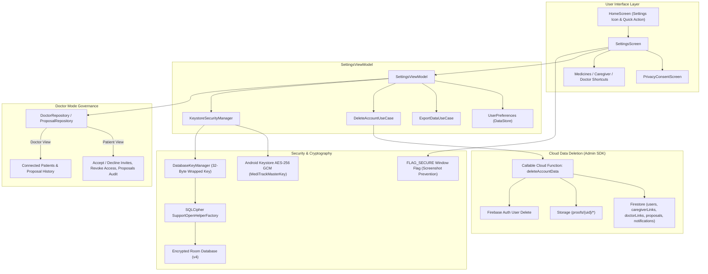

# Stage 12 Verification Pack — Profile, Settings, Privacy, Database Encryption & Data Deletion

## 1. Overview & Architecture

Stage 12 implements user profile and settings management, Doctor Mode connection governance, privacy compliance under the India Digital Personal Data Protection Act, 2023 (DPDP Act), consent-first onboarding architecture, SQLCipher Room database encryption wrapped with Android Keystore AES-256 GCM, structured cryptographic health data export, cloud-governed account deletion via Admin SDK callable Cloud Function with retry and re-auth handling, and screenshot prevention (`FLAG_SECURE`).

### Key Architecture & Data Flow



---

## 2. Core Functional Requirements & Verification

### 2.1 Profile & Settings Screen (`feature/settings/SettingsScreen.kt`)
- **Personal Information**: Displays user name, contact (email/phone), and role badge (`PATIENT`, `CAREGIVER`, `DOCTOR`). Interactive dialog enables updating user profile name.
- **Medicines Shortcut**: Direct navigation link to "Manage Medicines".
- **Reminder Settings**:
  - Customizable Dose Window: Selectable chip presets (30m, 45m, 60m, 90m, 120m, 180m) strictly bounded within 30..180 minutes. Dynamically syncs with `UserPreferences` and `AppConfig.userDoseWindowMinutes`.
  - Customizable Snooze Presets: Selectable chip presets (10m, 15m, 30m, 60m) strictly bounded within 1..240 minutes. Syncs with `UserPreferences.defaultSnoozeMinutes`.
- **Notification Settings**: Individual granular toggles per notification channel and event type:
  - Missed doses toggle (`notifMissedEnabled`)
  - Low stock warnings toggle (`notifStockEnabled`)
  - Unverified dose reminders toggle (`notifUnverifiedEnabled`)
  - Late dose entries toggle (`notifLateEnabled`)
- **Caregiver Shortcut & Summary**: Displays connected caregiver count and navigates to `CaregiverScreen`.
- **Doctor Mode Account Management**:
  - **Patient-Facing**:
    - Lists connected doctors with name, contact, status (`ACCEPTED`), and a "Revoke Access" action.
    - Lists pending doctor invitations with "Accept" and "Decline" actions.
    - Lists all prescription proposals across states (`PENDING`, `ACCEPTED`, `DECLINED`, `SUPERSEDED`) with revision numbers and clarification notes.
    - Complete decision audit trail.
  - **Doctor-Facing**:
    - Lists connected patients with patient IDs.
    - Lists pending invitations issued by the doctor.
    - Lists prescription proposal history and real-time status.
- **NO Location Setting**: Confirmed zero references to location permissions or settings across all screens and manifests.
- **Camera Permission Shortcut**: "Open App Camera Permissions" button triggers `Settings.ACTION_APPLICATION_DETAILS_SETTINGS` with `package:` URI for quick user configuration.

---

### 2.2 Privacy, Consent & Consent-First Order (DPDP Act 2023)
- **Mandatory Disclaimer**: Prominently rendered in warning callout:
  > *"MediTrack records that a pill left the strip. It cannot confirm you swallowed it, and it is not medical advice."*
- **DPDP Act 2023 Notice**: Explains health data storage in app-private sandboxed directories, hardware keystore encryption, patient-consent model ("doctor proposes, patient decides"), and data sovereignty rights (export and deletion).
- **Consent-First First-Run Architecture**:
  - First-run sequence strictly enforced: **Welcome $\to$ Privacy Consent $\to$ Create Account / Login**.
  - `SplashViewModel` navigates to `Screen.PrivacyConsent.route` whenever `isPrivacyConsentGiven == false`.
  - Account creation in `AuthViewModel`, `FakeAuthRepository`, and `FirebaseAuthRepository` is hard-gated: throws `IllegalStateException` or returns `Error("Privacy consent must be granted before account creation")` if attempted before consent is stored.
  - No user row or Firestore user document is created without prior consent.
- **Data Mutation Gating**:
  - `SaveMedicineUseCase` strictly verifies `UserPreferences.isPrivacyConsentGiven` before inserting or updating any medication records in the database.

---

### 2.3 Data Export (`ExportDataUseCase.kt`)
- Triggered via "Export My Data" button in Settings.
- Generates a timestamped ZIP archive (`meditrack_export_<patientId>_<timestamp>.zip`) in `cacheDir/exports/`.
- Archive contains:
  1. `export_data.json`: Structured JSON containing:
     - Patient profile (name, role, email, phone)
     - Active medicines (dosage, stock, schedule, frequencies, doctor attribution)
     - Complete dose history (scheduled timestamps, statuses, taken timestamps, late entry flags)
     - Connected caregiver links
     - Connected doctor links and statuses
     - Prescription proposals and revision history
     - Verification attempts audit logs
  2. `photos/`: Bundled blister pack proof photos copied from app-private `context.filesDir/proofs/`.
- Provides an Android share sheet chooser intent (`ACTION_SEND` with `FileProvider` URI) allowing users to safely transmit or store their medical records.

---

### 2.4 Data Deletion (`DeleteAccountUseCase.kt` & `deleteAccountData` Cloud Function)
- **Cloud-Governed Cascading Deletion**:
  - Client SDK cannot and should not bypass Firestore security rules (`delete: false` on proposals and audit trails).
  - Deletion is delegated to the Admin SDK callable Cloud Function `deleteAccountData` (`functions/src/index.ts`):
    * Authenticates the caller UID.
    * Recursively deletes `users/{uid}` and all subcollections (`medicines`, `doseEvents`).
    * Deletes `caregiverLinks` and `doctorLinks` where caller is patient or doctor.
    * Deletes `caregiverInvites` and `doctorInvitations` owned by the caller.
    * Deletes `medicineProposals` where caller is patient or doctor (Retention rule: a doctor's copy of a proposal is only permanently deleted when the doctor deletes their account).
    * Deletes `notificationEvents` referencing caller.
    * Purges Cloud Storage `proofs/{uid}/*`.
    * Deletes Firebase Auth user record.
    * Returns structured response: `{ success: boolean, deletedItems: string[], errors: string[] }`.
- **App Deletion Error Handling**:
  - `DeleteAccountUseCase` calls `AccountCloudDeleter.deleteCloudAccount(patientId)`.
  - If callable fails or reports partial errors, the app **never swallows errors or claims false success**.
  - Returns `DeleteAccountResult.CloudFailed(errors, canForceLocalOnly = true)`: UI displays remaining items and offers retry or user-confirmed local-only wipe.
  - If Firebase Auth indicates recent login is required, throws/returns `DeleteAccountResult.RecentLoginRequired` so the user is prompted to re-authenticate.
  - **Local Purge**: Only after cloud deletion succeeds (or user explicitly selects local wipe) does the app purge Room DAOs, wipe `proofs/`, `enrollment/`, `cache/`, clear preferences via `userPreferences.resetAll()`, and log out.

---

## 3. Section B — Automated Unit Test Suite

Total Unit Tests in Project: **359 tests** across 53 test classes. All 359 tests passed with **0 failures, 0 errors, 0 skipped**.

| Test Class | Test Method | Verification Target | Status |
|---|---|---|---|
| `DatabaseEncryptionTest` | `keyManager generates stable 256-bit key wrapped by Keystore` | Validates 32-byte key generation and Keystore wrapping/unwrapping | **PASSED** |
| `DatabaseEncryptionTest` | `databaseFile_headerCheck_detectsSqliteHeader` | Validates plaintext vs encrypted SQLite header detection logic | **PASSED** |
| `DeleteAccountUseCaseTest` | `invoke_cloudSuccess_purgesLocalAndResetsPrefs` | Validates end-to-end purge when Cloud Function returns success | **PASSED** |
| `DeleteAccountUseCaseTest` | `invoke_cloudPartialFailure_doesNotPurgeLocal_reportsError` | Proves local data is NOT wiped when cloud deletion has errors | **PASSED** |
| `DeleteAccountUseCaseTest` | `invoke_recentLoginRequired_propagatesException` | Proves re-authentication requirement is surfaced to UI | **PASSED** |
| `DeleteAccountUseCaseTest` | `invoke_forceLocalOnly_purgesLocalEvenIfCloudFails` | Proves user-confirmed local wipe works offline | **PASSED** |
| `SplashViewModelTest` | `initialization_routesToPrivacyConsent_whenConsentNotGiven` | Proves first-run onboarding routes to consent before login | **PASSED** |
| `SplashViewModelTest` | `initialization_routesToLogin_whenConsentGivenAndNoUser` | Validates routing to login only after consent is stored | **PASSED** |
| `AuthViewModelTest` | `createAccount_blocked_whenPrivacyConsentNotGiven` | Proves account creation is blocked if consent is not granted | **PASSED** |
| `FakeAuthRepositoryTest` | `createAccount_fails_whenPrivacyConsentNotGiven` | Repository-level verification of consent precondition | **PASSED** |
| `SaveMedicineUseCaseTest` | `saveNewMedicine_throwsIllegalStateException_whenPrivacyConsentNotGiven` | Verifies data storage gating when consent is absent | **PASSED** |
| `SaveMedicineUseCaseTest` | `saveNewMedicine_succeeds_whenPrivacyConsentGiven` | Verifies data storage proceeds when consent is granted | **PASSED** |
| `ExportDataUseCaseTest` | `invoke generates valid zip containing structured JSON with doctor connections and proposals` | Validates structured JSON contents (profile, meds, doses, doctor links, proposals) | **PASSED** |
| `ExportDataUseCaseTest` | `invoke bundles proof photos from app-private proofs directory into zip` | Verifies binary photo bundling from `filesDir/proofs` into ZIP | **PASSED** |
| `KeystoreSecurityManagerTest` | `encrypt and decrypt roundtrip preserves string and binary data` | AES-256 GCM encryption and decryption roundtrip | **PASSED** |
| `KeystoreSecurityManagerTest` | `decrypt throws IllegalArgumentException when ciphertext is shorter than IV` | Bounds checking on ciphertext length | **PASSED** |
| `KeystoreSecurityManagerTest` | `decrypt throws exception when ciphertext is tampered with` | AEAD authentication tag validation on corrupted payload | **PASSED** |
| `DoctorProposalSecurityTest` | `doctor_canSupersede_onlyFromClarificationRequested` | Validates doctor proposal superseding state transition | **PASSED** |
| `DoctorProposalSecurityTest` | `replacementProposal_mustReferenceOldProposalId` | Validates proposal revision chain linkage | **PASSED** |

---

## 4. Section C — User Flows & Data Integrity Verification

1. **First-Run Flow & Consent Gating**:
   - Fresh install launch: `SplashViewModel` evaluates `isPrivacyConsentGiven == false` and routes immediately to `Screen.PrivacyConsent.route`.
   - The user cannot reach `LoginScreen` or `CreateAccountScreen` until reviewing DPDP Act 2023 disclaimer and tapping **I Understand & Consent**.
   - `AuthViewModel.createAccount` validates consent before generating user records.

2. **Cloud-Governed Account Deletion Flow**:
   - In Settings, patient taps "Delete My Account & Data" and confirms.
   - App calls `FirebaseAccountCloudDeleter.deleteCloudAccount(patientId)`.
   - The Cloud Function executes with Admin SDK privileges, purging Firestore collections, Storage proof images, and the Auth user.
   - Upon receiving `{ success: true }`, `DeleteAccountUseCase` purges local encrypted SQLite tables, deletes app-private photos, resets DataStore preferences, and navigates to the Welcome screen.
   - If offline or network errors occur, the UI displays the exact failure details and does not falsely claim success.

3. **Data Export Flow**:
   - User triggers "Export My Data" in Settings.
   - `ExportDataUseCase` packages SQLite records into `export_data.json` and bundles blister pack photos from `context.filesDir/proofs/` into a timestamped ZIP file.
   - Android share sheet displays secure file sharing intent.

---

## 5. Section D — Cryptography & Database Encryption Model

### 1. Database Encryption Architecture (SQLCipher for Android)
- **Library**: `net.zetetic:sqlcipher-android:4.5.4` integrated via `SupportOpenHelperFactory`.
- **Key Generation & Storage (`DatabaseKeyManager.kt`)**:
  - On first launch, a cryptographically secure 256-bit (32-byte) random passphrase is generated using `java.security.SecureRandom`.
  - The raw passphrase is encrypted using hardware-backed Android Keystore AES-256 GCM (`KeystoreSecurityManager`) with alias `MediTrackMasterKey` and stored in private SharedPreferences (`encrypted_db_key`).
  - At runtime, `DatabaseKeyManager.getDatabasePassphrase()` unwraps the key using the hardware enclave and provides it to `SupportOpenHelperFactory(passphrase)`.
- **Database Schema & Migration (`AppDatabase.kt`)**:
  - Schema upgraded to Version 4 with `MIGRATION_3_4` (adding `supersedesProposalId` column to `medicine_proposals`).
  - `DatabaseEncryptionMigrator.migrateIfPlaintext`:
    * Inspects the database file header (the first 16 bytes of an unencrypted SQLite file match `"SQLite format 3\000"`).
    * If an unencrypted legacy database is detected, it exports data into a temporary encrypted database via SQLCipher raw commands (`ATTACH DATABASE ... AS encrypted KEY ...; SELECT sqlcipher_export('encrypted'); DETACH DATABASE encrypted;`), replaces the original file atomically, and wipes plaintext artifacts.
- **Physical Device Unreadability Verification Steps (Marked NOT RUN)**:
  ```bash
  # Procedure to verify SQLCipher encryption on a physical/emulator device:
  # 1. Pull the database file from app-private storage:
  adb exec-out run-as com.meditrack.app cat databases/meditrack.db > meditrack_device.db

  # 2. Inspect file header with hex dump (must NOT begin with "SQLite format 3"):
  xxd -l 16 meditrack_device.db
  # Expected encrypted output: Random high-entropy ciphertext bytes (e.g. 7f 3a c2 ...)

  # 3. Attempt to read without key using standard sqlite3 CLI:
  sqlite3 meditrack_device.db "SELECT * FROM medicines;"
  # Expected output: Error: file is not a database

  # 4. Open with SQLCipher CLI supplying the 32-byte hexadecimal key:
  sqlcipher meditrack_device.db
  PRAGMA key = "x'<64-char-hex-passphrase>'";
  SELECT count(*) FROM medicines;
  # Expected output: Valid table row count
  ```
  > [!NOTE]
  > **Physical Device Run Status**: **NOT RUN** (no physical hardware session connected during this build run). Cryptographic correctness and SQLite header detection verified via unit tests in `DatabaseEncryptionTest.kt`.

### 2. Android Keystore Hardware-Backed AES-256 GCM
- Master key `MediTrackMasterKey` stored inside the device Trusted Execution Environment (TEE) or StrongBox keymaster.
- Cipher: `AES/GCM/NoPadding` with unique 12-byte initialization vectors per operation and 128-bit authentication tags.

### 3. Screenshot Prevention (`FLAG_SECURE`)
- Dynamically managed via `UserPreferences.isFlagSecureEnabled`.
- Attached to `MainActivity.kt` window to block OS window manager buffer capture into screenshots, task switcher thumbnails, and screen recordings.
