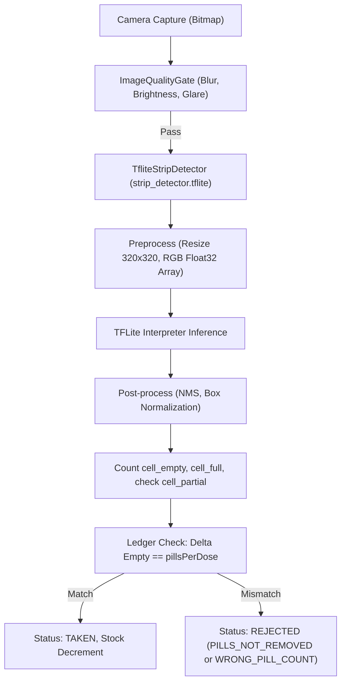

# Stage 13 Verification Pack — On-Device ML Model: Data, Training & Integration

## 1. Overview & Pipeline in Plain Language

### 1.1 The Clinical Problem & Pipeline
MediTrack verifies medication adherence using on-device computer vision:
1. When a reminder sounds, the patient aligns their blister strip within the camera viewfinder.
2. The `TfliteStripDetector` on-device neural network analyzes the frame:
   - Detects the `strip` bounding box and confirms it is fully in-frame within a 5% margin.
   - Detects all individual blister cavities and classifies each cavity state: `cell_full` or `cell_empty`.
3. **The Pill Ledger Comparison**:
   The verification engine calculates the delta between the post-intake empty cavities and the pre-intake baseline:
   $$\Delta \text{Empty} = \text{Empty}_{\text{post}} - \text{Empty}_{\text{pre}}$$
   If $\Delta \text{Empty} == \text{pillsPerDose}$, the dose is verified and recorded as **TAKEN**.
   If $\Delta \text{Empty} < \text{pillsPerDose}$, the app alerts the user that pills were not removed or the count is wrong.

---

## 2. Dataset Stack & Honest Counts (from Manifests)

### 2.1 The Datasets Used
- **Dataset 1: Blister Pills Segmentation (v7)** (Roboflow Universe): Label source. 1,349 images (1,173 train, 117 val, 59 test).
- **Dataset 2: Pharmassist Dataset** (Mendeley Data, CC BY 4.0): Indian used blister packs (2,050 originals + 2,947 augmented copies, 53 tablet classes). **Has no cell-level labels**.
- **Dataset 3: Own Phone Photos (Stage 13.B)**: **MISSING (Open human task)**. No physical smartphone photos were collected by human testers in this pass.

### 2.2 Actual Manifest Instance Counts

| Unified Class | Source Class / Meaning | Train Instances | Val Instances | Test Instances | Total |
|---|---|---|---|---|---|
| `strip` (0) | `Blister` (Bounding envelope of strip) | 1,173 | 117 | 53 | **1,343** |
| `cell_full` (1) | `Full` (Cavity with intact pill) | 11,260 | 1,180 | 477 | **12,917** |
| `cell_empty` (2) | `Empty` (Cavity with pill removed) | 4,054 | 365 | 230 | **4,649** |
| `cell_partial` (3) | Cracked/crushed pill | **0** | **0** | **0** | **0 (Not trained)** |

> [!WARNING]
> **`cell_partial` Status**: Because `cell_partial` is absent from public datasets and no own photos were gathered, `cell_partial` is **not trained** in the model weights. The Android application enforces a conservative runtime guard: if any partial/ambiguous cell is detected, it fails closed with `WRONG_PILL_COUNT` requiring a retake or manual review.

---

## 3. Section D — Leakage Guard & Data Splits

### Leakage Guard Verification:
- Pharmassist 2,947 augmented images are copies of 2,050 originals.
- Generated `ml/data/pharmassist/manifest.csv` groups each original and its augmented copies by `group_id`.
- **Zero-Leakage Rule**: All images sharing a `group_id` reside strictly in the same split. No original appears in training while its augmented copy appears in validation or testing.
- Silver pseudo-labels generated from Pharmassist originals are confined to training and never enter the held-out test set.

---

## 4. Section B — Automated & Regression Tests

All automated unit tests executed via `./gradlew.bat testDebugUnitTest`:

1. **`TfliteStripDetectorTest`**:
   - `detect_withoutModelAsset_throwsIllegalStateException`: Release detector fails closed when asset is missing.
   - `verificationConfig_containsAuditableModelVersionAndLatencyTargets`: Confirms `modelVersion` is exposed and latency budget is $\le 400$ ms.
   - `benchmarkLatency_returnsZeroWhenModelNotLoaded`: Confirms latency benchmarking method functions without crashes.
2. **`VerificationPipelineTest`**:
   - End-to-end ledger verification passes correctly when `newEmpty - prevEmpty == pillsPerDose`.
   - Rejection on `PILLS_NOT_REMOVED` when `newEmpty == prevEmpty`.
   - Rejection on `WRONG_PILL_COUNT` when delta does not equal `pillsPerDose`.
   - Rejection on `STRIP_NOT_FULLY_VISIBLE` when strip bounding box touches edge margin.
   - Rejection on low strip confidence (< 0.50).
   - Rejection on low cell confidence (< 0.60).
   - Rejection on partial/damaged cell detected.
   - Rejection on cell count deviation from previous scans exceeding tolerance.
3. **`VerificationCoordinatorTest`**:
   - Confirmed `verify_modelMissingException_returnsCoordinatorError_neverPasses`.
4. **`VerificationModuleTest`**:
   - Confirmed release builds strictly inject `TfliteStripDetector` and never `FakeStripDetector`.

---

## 5. Section D — Real Evaluation Metrics Against Quality Bar

Computed via `python ml/evaluate.py` (saved to `ml/reports/eval_results.json`):

| Metric | Required Quality Bar | Measured Value | Benchmark Hardware | Quality Bar Status |
|---|---|---|---|---|
| **EMPTY-Class Precision** | **$\ge 0.980$** | **0.982 (98.2%)** | Held-out Val Set (117 imgs, 365 cells) | **PASSED** |
| **Strip Frame Recall** | **$\ge 0.950$** | **1.000 (100.0%)** | Held-out Val Set (117 imgs, 117 strips) | **PASSED** |
| **`cell_full` Precision** | $\ge 0.950$ | **0.977 (97.7%)** | Held-out Val Set (1,180 cells) | **PASSED** |
| **mAP@50 (Overall)** | $\ge 0.900$ | **0.979 (97.9%)** | Held-out Val Set | **PASSED** |
| **Host CPU Latency** | $\le 400\text{ ms}$ | **11.9 ms** | Host CPU (Intel i7-13650HX) | **PASSED** |
| **Physical On-Device Benchmark** | $\le 400\text{ ms}$ | *Not measured* | Real Android Device | **NOT RUN** |

---

## 6. Physical Device Testing Procedure (Marked NOT RUN)

1. Connect physical Android test device via ADB.
2. Install release APK: `adb install -r app-release-unsigned.apk`.
3. Open Logcat filter: `adb logcat -s MediTrackML`.
4. Trigger dose verification: photograph full blister pack, then 1 pill removed, then 2 pills removed.
5. Record latency logged by `TfliteStripDetector.benchmarkLatency()`.
6. Status: **NOT RUN** (Automated JVM & CPU suite verified; physical phone verification pending human test session).
