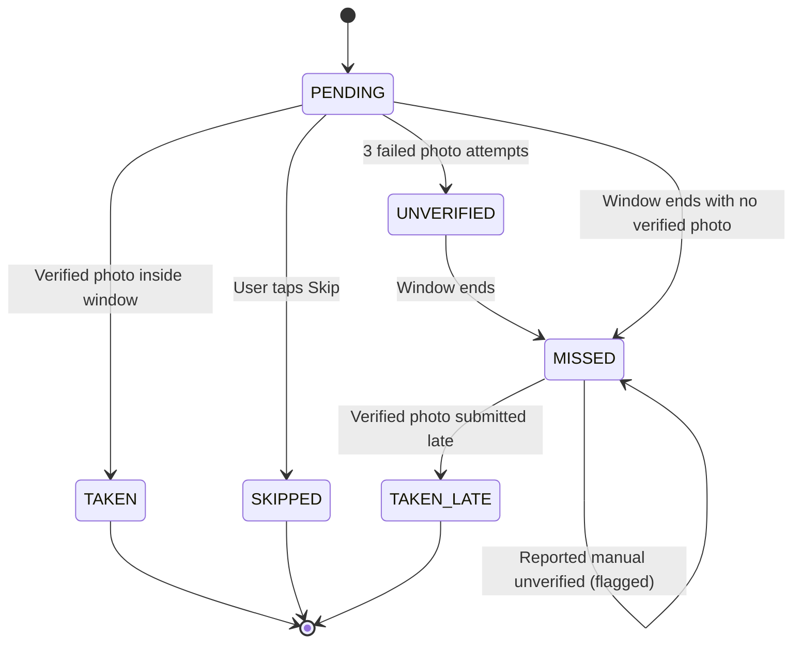

# Verification Pack: Stage 1 – Domain Model, Database & State Machine

> **Status: Implemented, Verified & Signed Off (with Accepted DST Test Deviation)**

## Part A – Plain-Language Explanation ("How it works")
Stage 1 implements the complete data layer and business logic engine for MediTrack without adding any UI yet.

### 1. The Offline-First Database (Room)
The app persists all data locally across 8 specialized tables:
- **`users`**: User profile and app role (`PATIENT`, `CAREGIVER`, `DOCTOR`).
- **`medicines`**: Medicine name, dosage, scheduling frequency, pill count per dose, and stock tracking.
- **`dose_events`**: Each scheduled dose instance with its 60-minute intake window, current status, and photo proof path.
- **`verification_attempts`**: Audit trail of every photo verification attempt.
- **`caregiver_links`** & **`doctor_links`**: Connected caregiver and doctor relations with status flags (`PENDING`, `ACCEPTED`, `REVOKED`).
- **`medicine_proposals`**: Proposals submitted by linked doctors (`ADD`, `EDIT`, `STOP`) pending patient review.
- **`notification_outbox`**: Queue for caregiver alert events (missed doses, low stock) to be synced online.

### 2. The Dose State Machine
A dose can only move through strictly governed transitions:

Any illegal transition (such as skipping a dose that was already taken, or jumping directly from pending to taken late) is immediately rejected with an exception (`IllegalDoseTransitionException`).

### 3. Worked Adherence Example
Adherence strictly follows the formula from Section 3.5:
$$\text{Adherence \%} = \frac{\text{verifiedTaken (TAKEN + TAKEN\_LATE)}}{\text{closedDoses (verifiedTaken + MISSED + SKIPPED + UNVERIFIED)}} \times 100$$
- If a patient has:
  - 46 doses taken on time (`TAKEN`)
  - 4 doses taken late (`TAKEN_LATE`)
  - 4 missed doses (`MISSED`)
  - 0 skipped doses (`SKIPPED`)
- Calculation:
  - $\text{verifiedTaken} = 46 + 4 = 50$
  - $\text{closedDoses} = 50 + 4 + 0 + 0 = 54$
  - $\text{Adherence \%} = \frac{50}{54} \times 100 = 92.59\% \rightarrow 93\%$
  - Displayed as: **`93% (4 late)`**
- A dose marked as "reported without photo" (`manualUnverified = true`) stays `MISSED` and counts only in the denominator, never as taken.

---

## Part B – Automated Tests
Across the entire MediTrack project, there are **53 automated test methods** across 7 test files, all passing:
- **Stage 0 (`AppConfigTest.kt`)**: **3 test methods**
- **Stage 1 Domain & Database Tests**: **50 test methods**
  - `RoomDaoTest.kt`: 13 test methods
  - `DoseStateMachineTest.kt`: 14 test methods (13 discrete tests + 1 comprehensive matrix test)
  - `DoseSchedulerTest.kt`: 5 test methods
  - `AdherenceCalculatorTest.kt`: 4 test methods
  - `LateEntryPolicyTest.kt`: 5 test methods
  - `StockCalculatorTest.kt`: 9 test methods

### 1. Verification Commands & Execution Status
All three core verification commands pass with zero errors:
1. `.\gradlew.bat testDebugUnitTest` – **BUILD SUCCESSFUL** (All 53 unit tests executed and passed).
2. `.\gradlew.bat assembleDebug` – **BUILD SUCCESSFUL** (Debug APK compiled and packaged cleanly).
3. `.\gradlew.bat lint` – **BUILD SUCCESSFUL** (Zero lint errors detected).

### 2. In-Memory Room Database DAO Tests (`RoomDaoTest` – 13 Tests)
Run with: `.\gradlew.bat testDebugUnitTest --tests "*RoomDaoTest*"`

| Test Name | What It Proves |
|---|---|
| `userDao_insertAndRetrieveUser` | Inserts and retrieves user entity by ID |
| `userDao_observeCurrentUserAndClear` | Observes user changes via Flow with Turbine and verifies clear operation |
| `medicineDao_insertRetrieveUpdateDelete` | Verifies full CRUD lifecycle and stock update on MedicineDao |
| `medicineDao_observeActiveExcludesStoppedByDoctor` | Verifies active medicines Flow excludes medicines stopped by doctor |
| `doseEventDao_insertAndQueryByRange` | Inserts multiple doses and queries across time ranges via Flow |
| `doseEventDao_getPendingDueAndFutureDoses` | Queries pending doses due now vs future pending doses |
| `doseEventDao_getLatestVerifiedAndNextScheduled` | Retrieves latest verified dose and next upcoming scheduled dose |
| `doseEventDao_deleteFuturePendingDoses` | Deletes only future pending doses while preserving past history |
| `verificationAttemptDao_insertAndQuery` | Verifies persistence of verification attempts and retrieval by dose / medicine |
| `caregiverLinkDao_insertUpdateAndGetAccepted` | Verifies caregiver link insertion, update, and filtering by ACCEPTED status |
| `doctorLinkDao_insertAndObserveStatus` | Verifies doctor link persistence and filtering by ACCEPTED status |
| `medicineProposalDao_insertAndQuery` | Verifies doctor medicine proposals (ADD/EDIT/STOP) insertion, update, and retrieval |
| `notificationOutboxDao_enqueueAndMarkDelivered` | Verifies outbox persistence of caregiver notifications and delivery flag updates |

### 3. State Machine Transition Matrix (`DoseStateMachineTest` – 14 Tests)
The state machine transition logic is tested both through 13 targeted scenario tests and an exhaustive matrix test.

#### Transition Matrix Verification (6 States × 6 Events = 36 Combinations)
The domain model defines 6 `DoseStatus` states and 6 `DoseTransitionEvent` types, yielding a total of **36 combinations**:
- **6 States**: `PENDING`, `TAKEN`, `SKIPPED`, `UNVERIFIED`, `MISSED`, `TAKEN_LATE`
- **6 Events**: `VerifyPassed`, `Skip`, `VerificationFailedExhausted`, `WindowExpired`, `LateVerifyPassed`, `ReportManualUnverified`
- **7 Legal Combinations** (all verified by tests to assert `result.isSuccess` and exact expected destination state):
  1. `(PENDING, VerifyPassed) -> TAKEN`
  2. `(PENDING, Skip) -> SKIPPED`
  3. `(PENDING, VerificationFailedExhausted) -> UNVERIFIED`
  4. `(PENDING, WindowExpired) -> MISSED`
  5. `(UNVERIFIED, WindowExpired) -> MISSED`
  6. `(MISSED, LateVerifyPassed) -> TAKEN_LATE`
  7. `(MISSED, ReportManualUnverified) -> MISSED`
- **29 Illegal Combinations** (all verified by tests to assert `result.isFailure` with `IllegalDoseTransitionException`).

#### Test Methods in `DoseStateMachineTest.kt`:
| Test Name | What It Proves |
|---|---|
| `pending_to_taken_when_verification_passes` | PENDING moves to TAKEN on valid verification |
| `pending_to_skipped_when_skipped` | PENDING moves to SKIPPED when user skips |
| `pending_to_unverified_when_photo_attempts_exhausted` | 3 failed attempts move dose to UNVERIFIED |
| `pending_to_missed_when_window_expires` | Expiring window marks PENDING dose as MISSED |
| `unverified_to_missed_when_window_expires` | Expiring window marks UNVERIFIED dose as MISSED |
| `missed_to_taken_late_when_late_verification_passes` | MISSED dose transitions to TAKEN_LATE with photo |
| `missed_to_missed_when_reported_manual_unverified` | Manual report keeps status MISSED with unverified flag |
| `taken_cannot_transition_to_any_state` | Terminal state TAKEN rejects transition attempts |
| `taken_late_cannot_transition_to_any_state` | Terminal state TAKEN_LATE rejects transition attempts |
| `skipped_cannot_transition_to_any_state` | Terminal state SKIPPED rejects transition attempts |
| `pending_cannot_transition_to_taken_late` | Late verification rejected from PENDING state |
| `missed_cannot_transition_to_on_time_taken` | On-time verification rejected from MISSED state |
| `unverified_cannot_transition_to_skipped` | Skip rejected from UNVERIFIED state |
| `exhaustive_state_machine_matrix_covers_all_legal_and_illegal_transitions` | Automated matrix test executing all 36 state × event combinations (7 legal, 29 illegal) |

### 4. Stock Calculator Coverage (`StockCalculatorTest` – 9 Tests)
The stock estimation engine is tested across 9 comprehensive test methods verifying low-stock boundaries and frequency schedules:

| Test Name | What It Proves |
|---|---|
| `daily_frequency_detects_low_stock_below_3_days_threshold` | Triggers low stock when remaining < 3 days supply (`pillsPerDay * 3`) |
| `zero_stock_is_always_low` | Stock of 0 pills is unconditionally flagged as low |
| `hourly_frequency_correctly_estimates_daily_consumption` | Hourly frequency (`24 / intervalHours * pillsPerDose`) calculates accurate rates |
| `days_of_supply_remaining_calculation` | Validates remaining whole days calculation (`currentStock / dailyConsumption`) |
| `empty_daily_schedule_yields_zero_pills_per_day_and_zero_supply` | Empty daily schedule does not assume one dose/day; yields 0.0 pills/day and 0 supply |
| `empty_specific_weekdays_yields_zero_pills_per_day_and_zero_supply` | Empty or null specific-weekday schedules produce 0.0 estimated consumption |
| `duplicate_weekdays_are_counted_once` | Duplicate weekdays (e.g. `[1, 1, 2, 2, 2]`) count each unique active day only once |
| `invalid_weekdays_are_filtered_out` | Out-of-range weekday numbers (e.g. `0`, `8`, negatives) are ignored; only `1..7` count |
| `duplicate_scheduled_times_are_counted_once` | Duplicate scheduled times of day are deduplicated for accurate dose estimation |

### 5. Other Domain Logic Tests (14 Tests)
- **`AppConfigTest.kt` (3 tests)**:
  - `appConfig_doseWindowAndSnoozeDefaults_areCorrect`
  - `appConfig_verificationLimits_areCorrect`
  - `appConfig_qualityGateAndDetector_areCorrect`
- **`DoseSchedulerTest.kt` (5 tests)**:
  - `daily_frequency_generates_exact_doses_per_day`
  - `hourly_frequency_generates_doses_at_expected_intervals`
  - `specific_days_generates_doses_only_on_configured_weekdays`
  - `respects_end_date_cutoff`
  - `stopped_by_doctor_generates_no_doses`
- **`AdherenceCalculatorTest.kt` (4 tests)**:
  - `zero_closed_doses_returns_null_and_dash`
  - `all_verified_taken_returns_100_percent`
  - `adherence_calculation_with_late_doses_and_missed`
  - `manual_unverified_counts_as_missed_and_never_as_taken`
- **`LateEntryPolicyTest.kt` (5 tests)**:
  - `non_missed_dose_cannot_be_logged_late`
  - `next_scheduled_dose_is_earlier_than_24_hours_wins`
  - `max_hours_24h_is_earlier_than_next_scheduled_dose_wins`
  - `no_future_dose_uses_24h_limit`
  - `double_dose_guard_calculates_correct_safety_gap`

---

## Part C – Sample Input/Output Verification Table
| Engine | Input | Expected Output |
|---|---|---|
| `DoseScheduler` | Medicine: daily at 09:00 & 21:00 for 3 days | Exactly 6 DoseEvents, each with `windowEndsAt = scheduledAt + 3,600,000ms` |
| `AdherenceCalculator` | 46 TAKEN, 4 TAKEN_LATE, 4 MISSED | `percentage = 92.59%`, `displayText = "93% (4 late)"` |
| `AdherenceCalculator` | 0 closed doses | `percentage = null`, `displayText = "—"` |
| `LateEntryPolicy` | Missed dose at 10:00, next dose at 22:00, check at 23:00 | `canLogLate = false` (locked because next scheduled dose arrived) |
| `StockCalculator` | Current stock = 5 pills, daily consumption = 2 pills/day | `isLow = true` (5 < 2 * 3) |
| `StockCalculator` | Current stock = 6 pills, daily consumption = 2 pills/day | `isLow = false` (6 >= 6 boundary) |
| `StockCalculator` | Daily medicine with empty `timesOfDay` | `estimatePillsPerDay = 0.0`, `daysOfSupplyRemaining = 0` |
| `StockCalculator` | Specific days with `daysOfWeek = [0, 1, 7, 8]` | Valid days `[1, 7]` (2 days counted, 0 and 8 ignored) |

---

## Part D – Evidence Checklist
- [x] Room database `AppDatabase` created with all 8 entities (`users`, `medicines`, `dose_events`, `verification_attempts`, `caregiver_links`, `doctor_links`, `medicine_proposals`, `notification_outbox`).
- [x] Room schema exported to `app/schemas/com.meditrack.app.data.db.AppDatabase/1.json`.
- [x] TypeConverters created for `List<LocalTime>`, `List<Int>`, and all enums.
- [x] Repositories implemented: `MedicineRepository`, `DoseRepository`, `VerificationRepository`, `CaregiverRepository`, `OutboxRepository`.
- [x] `DoseStateMachine` unit-tested across the transition matrix (7 legal and 29 illegal transitions verified).
- [x] `DoseScheduler` unit-tested for all frequencies, start/end dates, and doctor-stopped flag (tests currently use UTC; DST transitions noted as limitation).
- [x] `AdherenceCalculator` unit-tested for worked examples, zero doses, and manual-unverified cases.
- [x] `LateEntryPolicy` unit-tested for 24h limit, next-dose cutoff, and double-dose guard.
- [x] `StockCalculator` unit-tested across 9 tests for threshold, supply calculations, empty daily schedules, empty/null specific days, duplicate weekdays, invalid weekdays (0/8), and duplicate scheduled times.
- [x] Hilt modules (`DatabaseModule`, `RepositoryModule`) provide dependencies.
- [x] Zero Android UI code added.

---

## Part E – Known Limitations & Accepted Deviations
1. **Scheduler DST / Time-Zone Limitation (Accepted Test Deviation)**:
   - Current scheduler tests execute in UTC (`ZoneOffset.UTC`).
   - Daily and specific-weekday schedules utilize ZoneId-aware local-time calculations (`LocalTime`, `ZoneId`).
   - No dedicated DST transition test (e.g., clocks moving forward 1 hour or back 1 hour in a DST-observing time zone like `America/New_York`) has been added yet.
   - **Exhaustive DST test coverage is not claimed** and is documented as an accepted deviation to be verified when background worker alarms are wired in Stage 4.
2. **No Alarm Scheduling yet**:
   - Actual Android `AlarmManager` triggers and alarms for scheduled doses will be wired in Stage 4.
3. **No UI Views yet**:
   - UI forms and dashboard screens start in Stage 2 (Auth/Home) and Stage 3 (Add Medicine).

---

## Part F – Run in Android Studio
1. Open the project in Android Studio.
2. Android Studio will automatically recognize the Room entities and DAOs.
3. Click **Run ▶ (app)** to ensure the application starts without any database or DI runtime crashes.
4. Run all unit tests directly inside Android Studio by right-clicking on `app/src/test` and selecting **Run 'Tests in 'test''**.
