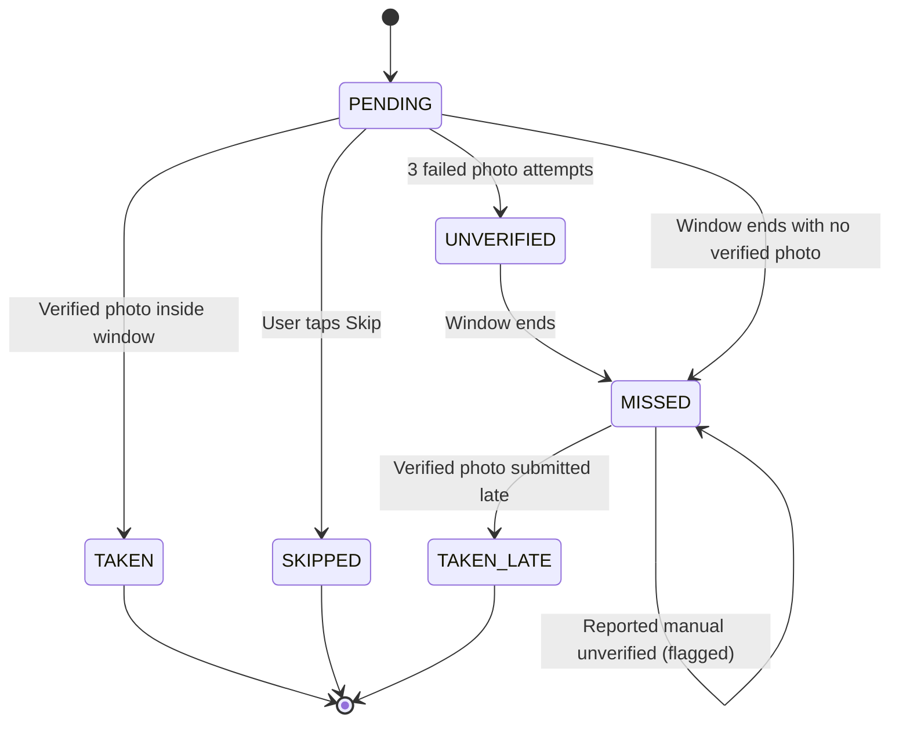

# Verification Pack: Stage 1 – Domain Model, Database & State Machine

## Part A – Plain-Language Explanation ("How it works")
Stage 1 implements the complete data layer and business logic engine for MediTrack without adding any UI yet.

### 1. The Offline-First Database (Room)
The app persists all data locally across 8 specialized tables:
- **`users`**: User profile and app role (`PATIENT`, `CAREGIVER`, `DOCTOR`).
- **`medicines`**: Medicine name, dosage, scheduling frequency, pill count per dose, and stock tracking.
- **`dose_events`**: Each scheduled dose instance with its 60-minute intake window, current status, and photo proof path.
- **`verification_attempts`**: Audit trail of every photo verification attempt.
- **`caregiver_links`** & **`doctor_links`**: Connected caregiver and doctor relations with status flags.
- **`medicine_proposals`**: Proposals submitted by linked doctors (ADD/EDIT/STOP) pending patient review.
- **`notification_outbox`**: Queue for caregiver alert events (missed doses, low stock) to be synced online.

### 2. The Dose State Machine
A dose can only move through strictly governed transitions:

Any illegal transition (such as skipping a dose that was already taken, or jumping directly from pending to taken late) is immediately rejected with an exception.

### 3. Worked Adherence Example
Adherence strictly follows the formula from Section 3.5:
$$\text{Adherence \%} = \frac{\text{verifiedTaken (TAKEN + TAKEN\_LATE)}}{\text{closedDoses (verifiedTaken + MISSED + SKIPPED + UNVERIFIED)}} \times 100$$
- If a patient has:
  - 46 doses taken on time (`TAKEN`)
  - 4 doses taken late (`TAKEN_LATE`)
  - 4 missed doses (`MISSED`)
  - 0 skipped doses (`SKIPPED`)
- Calculation:
  - $\text{verifiedTaken} = 46 + 4 = 50$
  - $\text{closedDoses} = 50 + 4 + 0 + 0 = 54$
  - $\text{Adherence \%} = \frac{50}{54} \times 100 = 92.59\% \rightarrow 93\%$
  - Displayed as: **`93% (4 late)`**
- A dose marked as "reported without photo" (`manualUnverified = true`) stays `MISSED` and counts only in the denominator, never as taken.

---

## Part B – Automated Tests
Total tests in project: **47 tests** (all passing).

### 1. In-Memory Room Database DAO Tests (`RoomDaoTest`)
Run with: `.\gradlew.bat testDebugUnitTest --tests "*RoomDaoTest*"`

| Test Name | What It Proves |
|---|---|
| `userDao_insertAndRetrieveUser` | Inserts and retrieves user entity by ID |
| `userDao_observeCurrentUserAndClear` | Observes user changes via Flow with Turbine and verifies clear operation |
| `medicineDao_insertRetrieveUpdateDelete` | Verifies full CRUD lifecycle and stock update on MedicineDao |
| `medicineDao_observeActiveExcludesStoppedByDoctor` | Verifies active medicines Flow excludes medicines stopped by doctor |
| `doseEventDao_insertAndQueryByRange` | Inserts multiple doses and queries across time ranges via Flow |
| `doseEventDao_getPendingDueAndFutureDoses` | Queries pending doses due now vs future pending doses |
| `doseEventDao_getLatestVerifiedAndNextScheduled` | Retrieves latest verified dose and next upcoming scheduled dose |
| `doseEventDao_deleteFuturePendingDoses` | Deletes only future pending doses while preserving past history |
| `verificationAttemptDao_insertAndQuery` | Verifies persistence of verification attempts and retrieval by dose / medicine |
| `caregiverLinkDao_insertUpdateAndGetAccepted` | Verifies caregiver link insertion, update, and filtering by ACCEPTED status |
| `doctorLinkDao_insertAndObserveStatus` | Verifies doctor link persistence and filtering by ACCEPTED status |
| `medicineProposalDao_insertAndQuery` | Verifies doctor medicine proposals (ADD/EDIT/STOP) insertion, update, and retrieval |
| `notificationOutboxDao_enqueueAndMarkDelivered` | Verifies outbox persistence of caregiver notifications and delivery flag updates |

### 2. Domain State Machine, Scheduler & Business Logic Tests
| Test Name | What It Proves | Command to Run |
|---|---|---|
| `appConfig_doseWindowAndSnoozeDefaults_areCorrect` | Proves dose window is 60m, snoozes default to [15, 30]m, and max snoozes is 3 | `.\gradlew.bat testDebugUnitTest --tests "*AppConfigTest*"` |
| `appConfig_verificationLimits_areCorrect` | Proves max verification attempts is 3 and late dose window is 24h | `.\gradlew.bat testDebugUnitTest --tests "*AppConfigTest*"` |
| `appConfig_qualityGateAndDetector_areCorrect` | Proves blur, brightness, glare, pHash, OCR match, and stock thresholds are exact | `.\gradlew.bat testDebugUnitTest --tests "*AppConfigTest*"` |
| `pending_to_taken_when_verification_passes` | Proves PENDING moves to TAKEN on valid verification | `.\gradlew.bat testDebugUnitTest --tests "*DoseStateMachineTest*"` |
| `pending_to_skipped_when_skipped` | Proves PENDING moves to SKIPPED when user skips | `.\gradlew.bat testDebugUnitTest --tests "*DoseStateMachineTest*"` |
| `pending_to_unverified_when_photo_attempts_exhausted` | Proves 3 failed attempts move dose to UNVERIFIED | `.\gradlew.bat testDebugUnitTest --tests "*DoseStateMachineTest*"` |
| `pending_to_missed_when_window_expires` | Proves expiring window marks PENDING dose as MISSED | `.\gradlew.bat testDebugUnitTest --tests "*DoseStateMachineTest*"` |
| `unverified_to_missed_when_window_expires` | Proves expiring window marks UNVERIFIED dose as MISSED | `.\gradlew.bat testDebugUnitTest --tests "*DoseStateMachineTest*"` |
| `missed_to_taken_late_when_late_verification_passes` | Proves MISSED dose transitions to TAKEN_LATE with photo | `.\gradlew.bat testDebugUnitTest --tests "*DoseStateMachineTest*"` |
| `missed_to_missed_when_reported_manual_unverified` | Proves manual report keeps status MISSED with unverified flag | `.\gradlew.bat testDebugUnitTest --tests "*DoseStateMachineTest*"` |
| `taken_cannot_transition_to_any_state` | **Negative test**: Proves TAKEN doses cannot be altered | `.\gradlew.bat testDebugUnitTest --tests "*DoseStateMachineTest*"` |
| `taken_late_cannot_transition_to_any_state` | **Negative test**: Proves TAKEN_LATE doses cannot be altered | `.\gradlew.bat testDebugUnitTest --tests "*DoseStateMachineTest*"` |
| `skipped_cannot_transition_to_any_state` | **Negative test**: Proves SKIPPED doses cannot be altered | `.\gradlew.bat testDebugUnitTest --tests "*DoseStateMachineTest*"` |
| `pending_cannot_transition_to_taken_late` | **Negative test**: Proves late intake cannot bypass missed state | `.\gradlew.bat testDebugUnitTest --tests "*DoseStateMachineTest*"` |
| `missed_cannot_transition_to_on_time_taken` | **Negative test**: Proves missed doses cannot be marked on-time | `.\gradlew.bat testDebugUnitTest --tests "*DoseStateMachineTest*"` |
| `unverified_cannot_transition_to_skipped` | **Negative test**: Proves unverified doses cannot be skipped | `.\gradlew.bat testDebugUnitTest --tests "*DoseStateMachineTest*"` |
| `daily_frequency_generates_exact_doses_per_day` | Proves daily scheduler creates doses with 60m windows | `.\gradlew.bat testDebugUnitTest --tests "*DoseSchedulerTest*"` |
| `hourly_frequency_generates_doses_at_expected_intervals` | Proves hourly scheduler generates doses every X hours | `.\gradlew.bat testDebugUnitTest --tests "*DoseSchedulerTest*"` |
| `specific_days_generates_doses_only_on_configured_weekdays` | Proves specific days scheduler only schedules on allowed days | `.\gradlew.bat testDebugUnitTest --tests "*DoseSchedulerTest*"` |
| `respects_end_date_cutoff` | Proves doses after medicine end date are never generated | `.\gradlew.bat testDebugUnitTest --tests "*DoseSchedulerTest*"` |
| `stopped_by_doctor_generates_no_doses` | **Negative test**: Proves stopped medicines generate zero doses | `.\gradlew.bat testDebugUnitTest --tests "*DoseSchedulerTest*"` |
| `zero_closed_doses_returns_null_and_dash` | Proves 0 closed doses returns null percentage and "—" | `.\gradlew.bat testDebugUnitTest --tests "*AdherenceCalculatorTest*"` |
| `all_verified_taken_returns_100_percent` | Proves all taken doses yield 100% adherence | `.\gradlew.bat testDebugUnitTest --tests "*AdherenceCalculatorTest*"` |
| `adherence_calculation_with_late_doses_and_missed` | Proves adherence math: 46 taken, 4 late, 4 missed = 93% | `.\gradlew.bat testDebugUnitTest --tests "*AdherenceCalculatorTest*"` |
| `manual_unverified_counts_as_missed_and_never_as_taken` | Proves manual unverified does not count in numerator | `.\gradlew.bat testDebugUnitTest --tests "*AdherenceCalculatorTest*"` |
| `non_missed_dose_cannot_be_logged_late` | **Negative test**: Proves non-missed doses cannot be logged late | `.\gradlew.bat testDebugUnitTest --tests "*LateEntryPolicyTest*"` |
| `next_scheduled_dose_is_earlier_than_24_hours_wins` | Proves late entry is locked once next scheduled dose arrives | `.\gradlew.bat testDebugUnitTest --tests "*LateEntryPolicyTest*"` |
| `max_hours_24h_is_earlier_than_next_scheduled_dose_wins` | Proves late entry is locked after 24 hours | `.\gradlew.bat testDebugUnitTest --tests "*LateEntryPolicyTest*"` |
| `no_future_dose_uses_24h_limit` | Proves standalone doses use standard 24h limit | `.\gradlew.bat testDebugUnitTest --tests "*LateEntryPolicyTest*"` |
| `double_dose_guard_calculates_correct_safety_gap` | Proves double dose warning triggers when within safety gap | `.\gradlew.bat testDebugUnitTest --tests "*LateEntryPolicyTest*"` |
| `daily_frequency_detects_low_stock_below_3_days_threshold` | Proves low stock triggers when remaining < 3 days supply | `.\gradlew.bat testDebugUnitTest --tests "*StockCalculatorTest*"` |
| `zero_stock_is_always_low` | Proves stock of 0 is flagged low | `.\gradlew.bat testDebugUnitTest --tests "*StockCalculatorTest*"` |
| `hourly_frequency_correctly_estimates_daily_consumption` | Proves hourly stock consumption rate calculation | `.\gradlew.bat testDebugUnitTest --tests "*StockCalculatorTest*"` |
| `days_of_supply_remaining_calculation` | Proves days-of-supply remaining math | `.\gradlew.bat testDebugUnitTest --tests "*StockCalculatorTest*"` |

---

## Part C – Sample Input/Output Verification Table
| Engine | Input | Expected Output |
|---|---|---|
| `DoseScheduler` | Medicine: daily at 09:00 & 21:00 for 3 days | Exactly 6 DoseEvents, each with `windowEndsAt = scheduledAt + 3,600,000ms` |
| `AdherenceCalculator` | 46 TAKEN, 4 TAKEN_LATE, 4 MISSED | `percentage = 92.59%`, `displayText = "93% (4 late)"` |
| `AdherenceCalculator` | 0 closed doses | `percentage = null`, `displayText = "—"` |
| `LateEntryPolicy` | Missed dose at 10:00, next dose at 22:00, check at 23:00 | `canLogLate = false` (locked because next scheduled dose arrived) |
| `StockCalculator` | Current stock = 5 pills, daily consumption = 2 pills/day | `isLow = true` (5 < 2 * 3) |
| `StockCalculator` | Current stock = 6 pills, daily consumption = 2 pills/day | `isLow = false` (6 >= 6 boundary) |

---

## Part D – Evidence Checklist
- [x] Room database `AppDatabase` created with all 8 entities.
- [x] Room schema exported to `app/schemas/com.meditrack.app.data.db.AppDatabase/1.json`.
- [x] TypeConverters created for `List<LocalTime>`, `List<Int>`, and all enums.
- [x] Repositories implemented: `MedicineRepository`, `DoseRepository`, `VerificationRepository`, `CaregiverRepository`, `OutboxRepository`.
- [x] `DoseStateMachine` unit-tested for all legal and illegal transitions.
- [x] `DoseScheduler` unit-tested for all frequencies, start/end dates, and doctor-stopped flag.
- [x] `AdherenceCalculator` unit-tested for worked examples, zero doses, and manual-unverified cases.
- [x] `LateEntryPolicy` unit-tested for 24h limit, next-dose cutoff, and double-dose guard.
- [x] `StockCalculator` unit-tested for threshold and supply calculations.
- [x] Hilt modules (`DatabaseModule`, `RepositoryModule`) provide dependencies.
- [x] Zero Android UI code added.

---

## Part E – Known Limitations & Risks
- **No Alarm Scheduling yet**: Alarms for scheduled doses will be wired in Stage 4.
- **No UI Views yet**: UI forms and dashboard integration will start in Stage 2 (Auth/Home) and Stage 3 (Add Medicine).

---

## Part F – Run in Android Studio
1. Open the project in Android Studio.
2. Android Studio will automatically recognize the Room entities and DAOs.
3. Click **Run ▶ (app)** to ensure the application starts without any database or DI runtime crashes.
4. Run all unit tests directly inside Android Studio by right-clicking on `app/src/test` and selecting **Run 'Tests in 'test''**.
