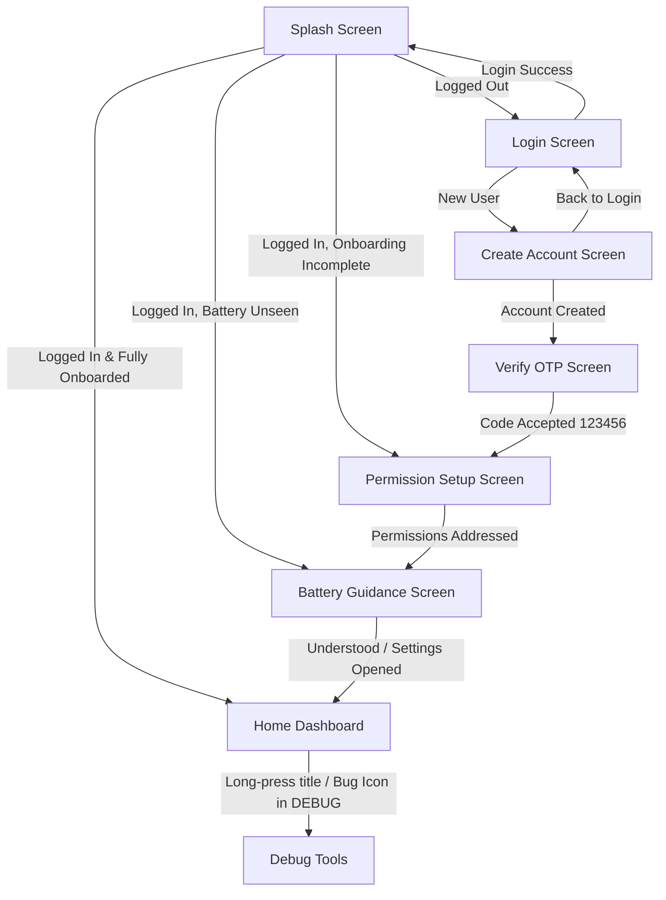

# Verification Pack: Stage 2 – Auth, Onboarding, Permission Setup & Home Shell

> **Status: Audit Corrections Implemented, Fully Tested (81/81 Passing), Awaiting User Review**

---

## Part A – Plain-Language Explanation ("How it works")

Stage 2 delivers the complete user-facing onboarding and authentication funnel, safety permission setup, battery optimization guidance, and the primary Home Dashboard shell.

### 1. Navigation Funnel Architecture


### 2. Deterministic Local Fake Authentication & Session Tracking
- **`AuthRepository`**: Pure domain interface exposing Kotlin `Flow` streams for current user, login state, onboarding state, and battery guidance state.
- **`FakeAuthRepository`**:
  - Validates contact and password deterministically against credentials stored locally.
  - Rejects unknown contacts with `"Account not found for <contact>"` with **no silent account creation**.
  - Rejects incorrect passwords with `"Incorrect password"`.
  - Uses an appropriately scoped SHA-256 demo password digest with salt (`MediTrackLocalDemoSalt_2026`) stored in DataStore per user ID. *(Clearly documented as demo-only for local offline development; real production auth will be handled by Firebase Auth in Stage 7/10).*
  - Normalizes email contacts case-insensitively and standardizes phone contacts without altering valid phone numbers.
  - Prevents duplicate registered contacts and duplicate pending registrations.
  - Preserves debug OTP `123456`. Failed OTP checks do not create a user or establish a session.
  - Successful OTP verification writes the user to Room exactly once and establishes the session.
  - Preserves user roles (`PATIENT`, `CAREGIVER`, `DOCTOR`). In accordance with the consent-based Doctor Mode, selecting Doctor identifies the user's application role without requiring or verifying medical credentials or registration numbers.
- **Session-Based Current User Observation**:
  - `observeCurrentUser()` reads `UserPreferences.currentUserId` and reactively transforms it via `flatMapLatest` to `userDao.observeUserById(userId)`.
  - Emits `null` when logged out. When multiple users exist in Room, it observes strictly the active session user, completely eliminating unsafe `SELECT * FROM users LIMIT 1` queries.
- **Device-Level Onboarding Persistence**:
  - `logout()` clears `isLoggedIn` and `currentUserId`, but strictly preserves device-level setup flags (`onboarding_completed`, `battery_guidance_seen`).

### 3. Permission Setup & Exact-Alarm / Camera Lifecycle Refresh
Permissions are explained individually with dedicated Material 3 cards:
1. **Camera**: Clearly marked as **Required for verification**.
   - Warning card is displayed **whenever camera permission is not granted** (including on initial screen display).
   - Re-checks camera status on resume via `LifecycleEventObserver(ON_RESUME)` when returning from Settings or permission dialogs.
   - User is permitted to continue onboarding to Battery Guidance if camera is initially denied.
2. **Post Notifications**: Explained for timely reminder alarms (`POST_NOTIFICATIONS` runtime on Android 13+).
3. **Exact Alarms**:
   - Deep links to `Settings.ACTION_REQUEST_SCHEDULE_EXACT_ALARM` on Android 12+ (API 31+).
   - Automatically refreshes `AlarmManager.canScheduleExactAlarms()` when the app resumes (`ON_RESUME`) from Android Settings.
4. **Photos / Files**: Explains that MediTrack uses the secure Android system photo picker; no storage permission requested.
5. **Contacts**: Optional, used to pick a caregiver contact (`READ_CONTACTS`).
6. **Internet**: Pre-granted manifest permission (`INTERNET`), displayed as active.

### 4. Manifest Permission Justification
MediTrack declares **ZERO** location permissions and **ZERO** email or SMS permissions. The retained permissions in `AndroidManifest.xml` are strictly justified by Stage 2 Task 7:
- `android.permission.INTERNET`: Required for backend sync, Firebase, and outbox delivery.
- `android.permission.CAMERA`: Required for blister pack photo verification (hardware marked `required="false"`).
- `android.permission.POST_NOTIFICATIONS`: Required for Android 13+ runtime reminder notifications.
- `android.permission.SCHEDULE_EXACT_ALARM`: Required for scheduling exact alarms on Android 12+ (paired with `AlarmManager.canScheduleExactAlarms()` and `Settings.ACTION_REQUEST_SCHEDULE_EXACT_ALARM`). Scoped with targeted `tools:ignore="ProtectedPermissions"` as it is user-granted via Android system settings rather than normal runtime prompt.
- `android.permission.RECEIVE_BOOT_COMPLETED`: Required to reschedule dose alarms upon device reboot.
- `android.permission.READ_CONTACTS`: Optional, used to select caregiver contacts.
- `android.permission.USE_FULL_SCREEN_INTENT`: Optional, used for high-priority full-screen dose alarms.

### 5. Battery Optimization Guidance Screen
Educates the patient on OEM background app limits (Xiaomi MIUI, Samsung OneUI, OnePlus OxygenOS, Huawei EMUI) and deep links to system battery settings (`Settings.ACTION_IGNORE_BATTERY_OPTIMIZATION_SETTINGS` with fallback to `Settings.ACTION_SETTINGS`).

### 6. Home Dashboard Shell & 24-Hour Time Windows
The dashboard reactively reads from Room:
- **Upcoming Doses**: Pending doses scheduled from the current instant through the next 24 hours (`now` to `now + 24 hours`). Correctly includes doses across midnight into the following day.
- **Missed Doses**: Missed doses scheduled within the 24-hour late verification window (`now - 24 hours` to `now`). Correctly includes yesterday's missed doses that have not expired, while excluding expired doses (>24h).
- **Today's Medicines & Doses**: Displays active medicines and today's schedule in device local time zone.
- **Unicode Safety**: Bullet separators use unicode escape `\u2022` to prevent encoding corruption (`•`).
- **Quick Action Placeholders**: Rendered as non-interactive dashboard chips for Stage 2 without dead-end routes.

---

## Part B – Automated Tests

Across the entire MediTrack project, there are **81 automated unit test methods** across 11 test files, **all passing (100%)**:
- **Stage 0 (`AppConfigTest.kt`)**: 3 tests
- **Stage 1 Domain & Database Tests**: 50 tests
  - `RoomDaoTest.kt`: 13 tests (In-memory Room with Robolectric)
  - `DoseStateMachineTest.kt`: 14 tests
  - `DoseSchedulerTest.kt`: 5 tests
  - `AdherenceCalculatorTest.kt`: 4 tests
  - `LateEntryPolicyTest.kt`: 5 tests
  - `StockCalculatorTest.kt`: 9 tests
- **Stage 2 Auth, Onboarding & Home Dashboard Tests**: 28 tests
  - `AuthViewModelTest.kt`: 11 tests
  - `SplashViewModelTest.kt`: 4 tests
  - `FakeAuthRepositoryTest.kt`: 10 tests (New audit tests)
  - `HomeViewModelTest.kt`: 3 tests (New audit tests)

### 1. Verification Commands & Execution Status
1. `.\gradlew.bat testDebugUnitTest` – **BUILD SUCCESSFUL in 1m 44s** (81 tests, 0 failures, 0 ignored)
2. `.\gradlew.bat assembleDebug` – **BUILD SUCCESSFUL in 13s** (Debug APK compiled cleanly)
3. `.\gradlew.bat lint` – **BUILD SUCCESSFUL in 1m 19s** (0 lint errors)

### 2. Stage 2 Test Methods Breakdown
| Test Class | Test Method Name | Description | Result |
| :--- | :--- | :--- | :--- |
| `FakeAuthRepositoryTest` | `successful registration and OTP verification establishes session and creates user` | Verifies full signup flow, OTP acceptance, Room insert, and session | **PASSED** |
| `FakeAuthRepositoryTest` | `failed OTP does not create user or establish session` | Verifies rejection of wrong OTP; prevents user creation or login | **PASSED** |
| `FakeAuthRepositoryTest` | `duplicate registered contact is rejected` | Rejects registration with existing email/phone (case-insensitive) | **PASSED** |
| `FakeAuthRepositoryTest` | `duplicate pending registration is rejected` | Rejects duplicate pending registration attempts | **PASSED** |
| `FakeAuthRepositoryTest` | `login succeeds with correct credentials` | Verifies deterministic login with matching password | **PASSED** |
| `FakeAuthRepositoryTest` | `login fails with incorrect password and does not log in` | Validates password failure; ensures user is not logged in | **PASSED** |
| `FakeAuthRepositoryTest` | `login fails with unknown contact without silent account creation` | Ensures no silent account creation occurs for unknown contacts | **PASSED** |
| `FakeAuthRepositoryTest` | `doctor registration succeeds without registration number` | Confirms Doctor role account creates and persists in Room without registration numbers | **PASSED** |
| `FakeAuthRepositoryTest` | `multi-user observation tests current session user when multiple users exist in Room` | Proves `observeCurrentUser` tracks the active session user, not `LIMIT 1` | **PASSED** |
| `FakeAuthRepositoryTest` | `logout clears session but preserves device level onboarding flags` | Confirms logout clears session while preserving device-level setup flags | **PASSED** |
| `HomeViewModelTest` | `upcoming doses include next day doses across midnight within 24 hours` | Tests upcoming doses spanning midnight into next morning | **PASSED** |
| `HomeViewModelTest` | `missed doses include yesterday missed dose within 24 hours across midnight` | Tests yesterday's missed doses within 24h, excludes expired (>24h) | **PASSED** |
| `HomeViewModelTest` | `missed doses exclude non-missed doses and upcoming doses exclude non-pending doses` | Validates status filtering for Home dashboard | **PASSED** |
| `AuthViewModelTest` | `login fails when contact is blank` | Validates contact requirement for login | **PASSED** |
| `AuthViewModelTest` | `login fails when password is blank` | Validates password requirement for login | **PASSED** |
| `AuthViewModelTest` | `login succeeds with valid credentials` | Validates successful login flow and callback | **PASSED** |
| `AuthViewModelTest` | `login displays error on repository failure` | Validates repository error handling on invalid credentials | **PASSED** |
| `AuthViewModelTest` | `registration fails when name is blank` | Validates name requirement during signup | **PASSED** |
| `AuthViewModelTest` | `registration fails when password length is less than 6` | Validates minimum 6-character password constraint | **PASSED** |
| `AuthViewModelTest` | `registration succeeds for doctor role without requiring registration number` | Validates doctor role registration succeeds without registration number | **PASSED** |
| `AuthViewModelTest` | `registration succeeds and invokes onNavigateToOtp` | Validates successful registration and navigation to OTP screen | **PASSED** |
| `AuthViewModelTest` | `verifyOtp fails when otp length is not 6` | Validates 6-digit OTP code format | **PASSED** |
| `AuthViewModelTest` | `verifyOtp succeeds when repository accepts code` | Validates accepted OTP code (`123456`) and success state | **PASSED** |
| `AuthViewModelTest` | `verifyOtp shows error when code is rejected` | Validates error presentation for wrong OTP code | **PASSED** |
| `SplashViewModelTest` | `navigates to Login when user is not logged in` | Directs unauthenticated session to Login screen | **PASSED** |
| `SplashViewModelTest` | `navigates to PermissionSetup when logged in but onboarding incomplete` | Directs authenticated user with incomplete onboarding to permissions | **PASSED** |
| `SplashViewModelTest` | `navigates to BatteryGuidance when logged in and onboarded but battery unseen` | Directs user through battery optimization guidance | **PASSED** |
| `SplashViewModelTest` | `navigates to Home when logged in and all onboarding and battery steps completed` | Directs returning, fully configured user directly to Home Dashboard | **PASSED** |

---

## Part C – Step-by-Step Manual Test Script

### Step 1: Fresh Install & Splash Routing
1. Install and launch the debug app.
2. Verify Splash screen shows logo and progress indicator briefly, then transitions to **Login**.

### Step 2: Account Creation & Role Validation
1. Tap **"Don't have an account? Create one"**.
2. Select **Doctor** chip. Confirm no Doctor Registration Number field or medical credential check is requested (consistent with consent-based Doctor Mode).
3. Select desired role chip (**Patient**, **Doctor**, or **Caregiver**). Enter Name (`John Doe`), Contact (`john@example.com`), and Password (`123456`).
4. Tap **"Send Verification Code"**. Confirm transition to **Verify Account** screen displaying `john@example.com`.

### Step 3: OTP Verification
1. Enter `000000`. Tap **"Verify & Continue"**. Confirm error `"Invalid verification code. Enter 123456"`.
2. Enter `123456`. Tap **"Verify & Continue"**.
3. Confirm transition to **Permission Setup** screen.

### Step 4: Permission Setup & Camera Warning
1. Observe 6 permission cards: Camera, Notifications, Exact Alarms, Photos & Files, Contacts, Internet.
2. Confirm the amber warning box is **visible immediately** because Camera has not yet been granted.
3. Tap **"Grant"** on Camera and allow permission. Note that the warning disappears immediately.
4. Tap **"Grant"** on Exact Alarms (opens System Settings). Enable exact alarms in Settings and press Back. Confirm the Exact Alarms card updates automatically to **"Granted"**.
5. Tap **"Continue"**. Confirm transition to **Battery Optimization Guidance**.

### Step 5: Battery Optimization Guidance
1. Read guidance bullet points regarding OEM background task killing.
2. Tap **"Open Battery Settings"** (verifies intent launch to system settings). Return to app.
3. Tap **"I Understand, Continue"**.
4. Confirm transition to **Home Dashboard**.

### Step 6: Home Dashboard Shell & Returning Session
1. Observe 4 core sections:
   - Today's Medicines (showing empty state).
   - Upcoming Doses (showing empty state).
   - Missed Doses (showing empty state).
   - Quick Action Placeholders (Add Medicine, Scan Rx, Calendar, History, Caregiver, Profile).
2. Long-press on the title "MediTrack" (or tap the bug icon in TopAppBar) to navigate to Debug Tools. Press Back to return to Home.
3. Force stop the app and re-launch. Confirm Splash screen routes **directly to Home Dashboard** without re-prompting login or onboarding.

---

## Part D – Evidence Checklist

- [x] **Zero Location & Email Permissions**: Proved via automated manifest and merged manifest audit:
  ```powershell
  Select-String -Path "app\intermediates\merged_manifest\debug\processDebugMainManifest\AndroidManifest.xml" -Pattern "LOCATION|READ_EMAILS|READ_SMS|WRITE_SMS|GET_ACCOUNTS"
  # Output: ZERO occurrences.
  ```
- [x] **No Silent Account Creation**: Verified by unit test `login fails with unknown contact without silent account creation`.
- [x] **Deterministic Password Checking**: Verified by unit test `login fails with incorrect password and does not log in`.
- [x] **Session-Based Multi-User Observation**: Verified by unit test `multi-user observation tests current session user when multiple users exist in Room`.
- [x] **24-Hour Dashboard Windows**: Verified by unit tests covering next-day doses spanning midnight and missed-dose 24h cutoff.
- [x] **On-Resume Permission Refresh**: Verified by `LifecycleEventObserver(ON_RESUME)` in `PermissionSetupScreen.kt`.

---

## Part E – Limitations & Out of Scope for Stage 2

As strictly defined by the stage boundaries in `README.md`:
1. **Medicine Reminders / Exact Alarms**: Stage 4 will implement WorkManager/AlarmManager workers and exact alarm broadcast receivers.
2. **Medicine Form / Manual Entry**: Stage 3 will implement medicine creation and blister pack baseline registration.
3. **ML Blister Verification**: Stage 5 and 6 will implement CameraX image capture and ML Kit/TFLite pill counting.
4. **Caregiver Cloud Sync**: Stage 7/10 will implement Firebase Cloud Sync and caregiver linking.

---

## Part F – Android Studio Run Steps

1. Launch Android Studio Meerkat.
2. Open project directory: `MedTracker - BioDesign`.
3. Wait for Gradle sync to complete (uses JDK 21 LTS).
4. Select build variant `debug` and target emulator or connected device running Android 10+ (API 29+).
5. Press **Run (Shift + F10)**.
6. To run all unit tests from Android Studio:
   - Right-click `app/src/test/java` ➔ **Run 'Tests in 'com.meditrack.app''**.
   - Verify all 81 tests pass green.
