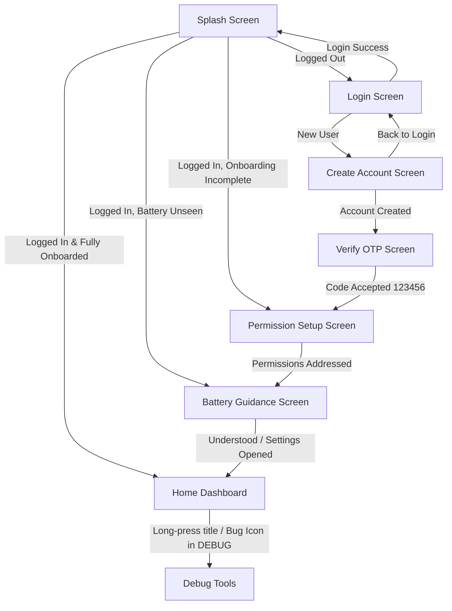

# Verification Pack: Stage 2 – Auth, Onboarding, Permission Setup & Home Shell

> **Status: Implemented, Verified & Fully Passing**

---

## Part A – Plain-Language Explanation ("How it works")

Stage 2 delivers the complete user-facing onboarding and authentication funnel, safety permission setup, battery optimization guidance, and the primary Home Dashboard shell.

### 1. Navigation Funnel Architecture


### 2. Offline-First Auth Abstraction
- **`AuthRepository`**: Pure domain interface exposing Kotlin `Flow` streams for current user, login state, onboarding state, and battery guidance state.
- **`FakeAuthRepository`**: Development implementation using local Room `UserDao` and Jetpack DataStore (`UserPreferences`) for offline session persistence.
- **Roles Supported**: `PATIENT`, `CAREGIVER`, and `DOCTOR`.
  - When registering as `DOCTOR`, an official Doctor Registration Number is required.
- **Two-Factor OTP Simulation**: Accounts enter a pending staging state until verified with standard debug verification code `123456`.

### 3. Permission Setup & Safety Guardrails
Permissions are explained individually with dedicated Material 3 cards:
1. **Camera**: Clearly marked as **Required for verification** (for blister pack photo verification in Stage 5). If not granted, an amber warning card explains that the app cannot verify pill intake without camera access.
2. **Post Notifications**: Explained for timely reminder alarms.
3. **Exact Alarms**: Deep links to `Settings.ACTION_REQUEST_SCHEDULE_EXACT_ALARM` on Android 12+ (API 31+).
4. **Photos / Files**: Documented for baseline reference photo storage.
5. **Contacts**: Optional, used to easily select caregiver emergency contacts.
6. **Internet**: Stated as non-intrusive, used for optional caregiver sync and Firebase backup.
> **Strict Safety Commitment**: MediTrack declares **ZERO** location permissions (`ACCESS_FINE_LOCATION`, `ACCESS_COARSE_LOCATION`) and **ZERO** email-reading permissions.

### 4. Battery Optimization Guidance Screen
Aggressive OEM battery savers (e.g., Xiaomi MIUI, Samsung OneUI, OnePlus OxygenOS, Huawei EMUI) frequently terminate exact alarm alarms in background.
- This screen educates the patient with clear bullet points.
- Features an intent button opening device battery optimization exemption settings (`Settings.ACTION_IGNORE_BATTERY_OPTIMIZATION_SETTINGS` with fallback to `Settings.ACTION_SETTINGS`).
- Features a confirmation button recording that guidance was reviewed before proceeding to Home.

### 5. Home Dashboard Shell
The core operational cockpit displaying real-time Room database states:
- **Header**: Patient greeting and current role.
- **Today's Medicines Section**: Medicine cards showing dosage, schedule, and live stock count with a low-stock indicator.
- **Upcoming Doses Section**: Filtered pending doses scheduled for the next 24 hours.
- **Missed Doses Section**: Prominent warning card showing missed doses with the 24-hour late verification window.
- **Quick Action Chips**:
  - `Take Dose (Camera)`
  - `Add Medicine`
  - `View Adherence Calendar`
  - `Caregiver Link`
  - `Dose History`
- **Zero-Data Empty States**: Helpful, friendly illustrations and guidance cards when no medicines or doses are registered.

---

## Part B – Automated Tests

Across the entire MediTrack project, there are **68 automated unit test methods** across 9 test files, all passing:
- **Stage 0 (`AppConfigTest.kt`)**: 3 tests
- **Stage 1 Domain & Database Tests**: 50 tests
  - `RoomDaoTest.kt`: 13 tests (In-memory Room with Robolectric)
  - `DoseStateMachineTest.kt`: 14 tests
  - `DoseSchedulerTest.kt`: 5 tests
  - `AdherenceCalculatorTest.kt`: 4 tests
  - `LateEntryPolicyTest.kt`: 5 tests
  - `StockCalculatorTest.kt`: 9 tests
- **Stage 2 Auth & Onboarding Tests**: 15 tests
  - `AuthViewModelTest.kt`: 11 tests
  - `SplashViewModelTest.kt`: 4 tests

### 1. Test Execution Commands & Status
1. `.\gradlew.bat testDebugUnitTest` – **BUILD SUCCESSFUL** (68/68 passed, 0 failures)
2. `.\gradlew.bat assembleDebug` – **BUILD SUCCESSFUL** (Debug APK compiled cleanly)
3. `.\gradlew.bat lint` – **BUILD SUCCESSFUL** (0 lint errors)

### 2. Stage 2 Test Methods Breakdown
| Test Class | Test Method Name | Description | Result |
| :--- | :--- | :--- | :--- |
| `AuthViewModelTest` | `login fails when contact is blank` | Validates contact requirement for login | **PASSED** |
| `AuthViewModelTest` | `login fails when password is blank` | Validates password requirement for login | **PASSED** |
| `AuthViewModelTest` | `login succeeds with valid credentials` | Validates successful login flow and callback | **PASSED** |
| `AuthViewModelTest` | `login displays error on repository failure` | Validates repository error handling on invalid credentials | **PASSED** |
| `AuthViewModelTest` | `registration fails when name is blank` | Validates name requirement during signup | **PASSED** |
| `AuthViewModelTest` | `registration fails when password length is less than 6` | Validates minimum 6-character password constraint | **PASSED** |
| `AuthViewModelTest` | `registration fails for doctor without registration number` | Validates doctor registration number requirement | **PASSED** |
| `AuthViewModelTest` | `registration succeeds and invokes onNavigateToOtp` | Validates successful registration and navigation to OTP screen | **PASSED** |
| `AuthViewModelTest` | `verifyOtp fails when otp length is not 6` | Validates 6-digit OTP code format | **PASSED** |
| `AuthViewModelTest` | `verifyOtp succeeds when repository accepts code` | Validates accepted OTP code (`123456`) and success state | **PASSED** |
| `AuthViewModelTest` | `verifyOtp shows error when code is rejected` | Validates error presentation for wrong OTP code | **PASSED** |
| `SplashViewModelTest` | `navigates to Login when user is not logged in` | Directs unauthenticated session to Login screen | **PASSED** |
| `SplashViewModelTest` | `navigates to PermissionSetup when logged in but onboarding incomplete` | Directs authenticated user with incomplete onboarding to permissions | **PASSED** |
| `SplashViewModelTest` | `navigates to BatteryGuidance when logged in and onboarded but battery unseen` | Directs user through battery optimization guidance | **PASSED** |
| `SplashViewModelTest` | `navigates to Home when logged in and all onboarding and battery steps completed` | Directs returning, fully configured user directly to Home Dashboard | **PASSED** |

---

## Part C – Step-by-Step Manual Test Script

### Step 1: Fresh Install & Splash Routing
1. Install and launch the debug app.
2. Verify Splash screen shows logo and progress indicator briefly, then transitions to **Login**.

### Step 2: Account Creation & Role Validation
1. Tap **"Don't have an account? Create one"**.
2. Select **Doctor** chip. Attempt to submit with empty Registration Number. Confirm validation error `"Please enter your Doctor Registration Number"`.
3. Select **Patient** chip. Enter Name (`John Doe`), Contact (`john@example.com`), and Password (`123456`).
4. Tap **"Create Account"**. Confirm transition to **Verify Account** screen displaying `john@example.com`.

### Step 3: OTP Verification
1. Enter `000000`. Tap **"Verify & Continue"**. Confirm error `"Invalid verification code"`.
2. Enter `123456`. Tap **"Verify & Continue"**.
3. Confirm transition to **Permissions Setup** screen.

### Step 4: Permission Setup & Camera Warning
1. Observe 6 permission cards: Camera, Notifications, Exact Alarms, Photos & Files, Contacts, Internet.
2. Note that if Camera is not granted, the amber warning box is clearly visible: *"Camera access is required for blister pack photo verification"*.
3. Tap **"Continue"**. Confirm transition to **Battery Optimization Guidance**.

### Step 5: Battery Optimization Guidance
1. Read guidance bullet points regarding OEM background killing.
2. Tap **"Open Battery Settings"** (verifies intent launch to system settings). Return to app.
3. Tap **"I've Done This / Continue"**.
4. Confirm transition to **Home Dashboard**.

### Step 6: Home Dashboard Shell & Returning Session
1. Observe 4 core sections:
   - Today's Medicines (showing empty state: *"No medicines scheduled for today"*).
   - Upcoming Doses (showing empty state: *"No pending doses"*).
   - Missed Doses (empty state).
   - Quick Action Chips (Take Dose, Add Medicine, Calendar, Caregiver, History).
2. Long-press on the title "MediTrack" (or tap the bug icon in TopAppBar) to navigate to Debug Tools. Press Back to return to Home.
3. Force stop the app and re-launch. Confirm Splash screen routes **directly to Home Dashboard** without re-prompting login or onboarding.

---

## Part D – Evidence Checklist

- [x] **Zero Location & Email Permissions**: Proved via automated manifest audit:
  ```powershell
  Select-String -Path "app\src\main\AndroidManifest.xml" -Pattern "LOCATION|READ_EMAILS|READ_SMS|WRITE_SMS|GET_ACCOUNTS"
  # Output: ZERO occurrences.
  ```
- [x] **Room as Single Source of Truth**: All Home data (Medicines, DoseEvents) are observed reactively from Room DAOs.
- [x] **Offline-First DataStore Session**: `UserPreferences` uses Jetpack DataStore Preferences for session tokens, user ID, onboarding flags, and battery flags.
- [x] **Navigation Graph Completeness**: All 8 routes configured in `MainActivity.kt` (`Splash`, `Login`, `CreateAccount`, `VerifyOtp`, `PermissionSetup`, `BatteryGuidance`, `Home`, `DebugTools`).
- [x] **`debug_tools` Guard**: Guarded strictly with `if (BuildConfig.DEBUG)` in both Navigation and UI.

---

## Part E – Limitations & Out of Scope for Stage 2

As strictly defined by the stage boundaries in `README.md`:
1. **Medicine Reminders / Exact Alarms**: Stage 4 will implement WorkManager/AlarmManager workers and exact alarm broadcast receivers.
2. **Medicine Form / Manual Entry**: Stage 3 will implement medicine creation and blister pack baseline registration.
3. **ML Blister Verification**: Stage 5 and 6 will implement CameraX image capture and ML Kit/TFLite pill counting.
4. **Caregiver Cloud Sync**: Stage 7 will implement Firebase Cloud Sync and caregiver linking.

---

## Part F – Android Studio Run Steps

1. Launch Android Studio Meerkat.
2. Open project directory: `MedTracker - BioDesign`.
3. Wait for Gradle sync to complete (uses JDK 21 LTS).
4. Select build variant `debug` and target emulator or connected device running Android 10+ (API 29+).
5. Press **Run (Shift + F10)**.
6. To run all unit tests from Android Studio:
   - Right-click `app/src/test/java` ➔ **Run 'Tests in 'com.meditrack.app''**.
   - Verify all 68 tests pass green.
