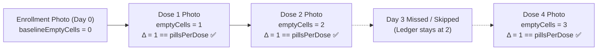

# Verification Pack: Stage 3 – Medicine Registration, Manual Entry & Blister Pack Baseline Creation

> **Status: Stage 3 Implemented, Fully Tested (100/100 Passing), Awaiting User Review**

---

## Part A – Plain-Language Explanation ("How it works")

Stage 3 delivers full medication lifecycle management (Add, Edit, List, Delete), automated rolling dose generation, blister pack baseline enrollment photography, and daily WorkManager schedule maintenance.

### 1. What the Baseline (Enrollment) Photo is and Why it is Needed Later

MediTrack uses a **count-based blister cell ledger** (defined in README Section 3.6) rather than fragile, whole-image pixel subtraction:
- When a patient registers a medication pack, they take an **enrollment photo** of the full, unopened (or currently active) blister pack.
- This establishes the starting baseline: `Medicine.baselineEmptyCells` (typically 0 for a brand-new strip) and persists the reference image at `Medicine.baselinePhotoPath`.
- In subsequent verification stages (Stages 5 & 6), whenever a dose is verified, the ML pipeline counts empty cells in the verification photo (`newEmpty`).
- The ledger rule enforces:
  $$\text{newEmpty} - \text{previousEmpty} == \text{pillsPerDose}$$
- Because the ledger compares against the most recent passing verification (or the baseline enrollment photo if no verified doses exist yet), the baseline photo provides the **indispensable ground truth** for pill counts.
- **Skipping Enrollment**: Patients are allowed to tap **"Skip for now"** during enrollment. In this case, `baselinePhotoPath = null`, and the app will require the baseline enrollment photo the first time intake verification is initiated.

### 2. Rolling 7-Day Dose Generation & WorkManager Extension

- **`DoseScheduler`**: Computes scheduled timestamps for `DAILY`, `HOURLY`, and `SPECIFIC_DAYS` frequencies, respecting `startDate` and optional `endDate`. Each dose event is assigned a deterministic ID (`${medicineId}_$scheduledAt`) and a 60-minute verification window (`windowEndsAt = scheduledAt + 60 min`).
- **Initial Horizon**: Upon saving a new medicine, `SaveMedicineUseCase` generates doses for a rolling **7 days ahead** starting from `medicine.startDate` (or today), bounded by `endDate` if specified.
- **`DailyDoseExtensionWorker`**: A WorkManager `PeriodicWorkRequest` scheduled daily. It scans active medicines and extends scheduled doses forward to maintain a continuous 7-day rolling horizon.

### 3. Edit & Delete Invariants (Preserving Dose History)

- **Editing a Medicine**:
  - Updates the `Medicine` record in Room.
  - Calls `doseRepository.deleteFuturePendingDoses(medicineId, now)`.
  - Regenerates upcoming doses from `maxOf(now, startDate)` through the rolling horizon.
  - **Critical Invariant**: All past dose events, completed doses (`TAKEN`, `TAKEN_LATE`), missed doses (`MISSED`), and skipped doses (`SKIPPED`) remain completely untouched.
- **Deleting a Medicine**:
  - Calls `doseRepository.deleteFuturePendingDoses(medicineId, now)` to remove future `PENDING` obligations.
  - Removes the `Medicine` entity.
  - Historical records in `dose_events` are preserved for adherence tracking.

---

## Part B – Automated Tests

Across the MediTrack project, there are now **100 automated unit test methods** across 15 test files, **all passing (100%)**:
- **Stage 0 (`AppConfigTest.kt`)**: 3 tests
- **Stage 1 Domain & Database Tests**: 50 tests
  - `RoomDaoTest.kt`: 13 tests
  - `DoseStateMachineTest.kt`: 14 tests
  - `DoseSchedulerTest.kt`: 5 tests
  - `AdherenceCalculatorTest.kt`: 4 tests
  - `LateEntryPolicyTest.kt`: 5 tests
  - `StockCalculatorTest.kt`: 9 tests
- **Stage 2 Auth & Home Dashboard Tests**: 28 tests
  - `AuthViewModelTest.kt`: 11 tests
  - `SplashViewModelTest.kt`: 4 tests
  - `FakeAuthRepositoryTest.kt`: 10 tests
  - `HomeViewModelTest.kt`: 3 tests
- **Stage 3 Medicine Management Tests**: 19 tests
  - `MedicineValidatorTest.kt`: 7 tests
  - `SaveMedicineUseCaseTest.kt`: 3 tests
  - `AddEditMedicineViewModelTest.kt`: 6 tests
  - `MedicinesListViewModelTest.kt`: 2 tests
  - `DailyDoseExtensionWorkerTest.kt`: 1 test

### 1. Verification Commands & Execution Status
1. `.\gradlew.bat testDebugUnitTest` – **BUILD SUCCESSFUL in 40s** (100 tests, 0 failures, 100% passing)
2. `.\gradlew.bat lint` – **BUILD SUCCESSFUL in 1m 10s** (0 lint errors)
3. `.\gradlew.bat assembleDebug` – **BUILD SUCCESSFUL** (Debug APK compiled cleanly)

### 2. Stage 3 Test Methods Breakdown
| Test Class | Test Method Name | Description | Result |
| :--- | :--- | :--- | :--- |
| `MedicineValidatorTest` | `valid_medicine_input_passes_validation` | Validates complete correct medicine configuration | **PASSED** |
| `MedicineValidatorTest` | `blank_name_fails_validation` | Rejects empty medicine name with friendly error | **PASSED** |
| `MedicineValidatorTest` | `pills_per_dose_less_than_one_fails_validation` | Enforces pills per dose $\ge 1$ | **PASSED** |
| `MedicineValidatorTest` | `end_date_earlier_than_start_date_fails_validation` | Rejects invalid date intervals | **PASSED** |
| `MedicineValidatorTest` | `empty_times_when_reminder_enabled_fails_validation` | Enforces reminder times when reminders are enabled | **PASSED** |
| `MedicineValidatorTest` | `empty_times_when_reminder_disabled_passes_validation` | Allows empty times when reminders are disabled | **PASSED** |
| `MedicineValidatorTest` | `non_positive_initial_stock_fails_validation` | Enforces initial stock $\ge 1$ | **PASSED** |
| `SaveMedicineUseCaseTest` | `saveNewMedicine_sets_current_stock_and_inserts_doses` | Sets stock = initial stock and generates 6 doses for 3-day 2/day schedule | **PASSED** |
| `SaveMedicineUseCaseTest` | `updateMedicine_deletes_future_pending_doses_and_regenerates_future_only` | Edits future doses only, preserving past history | **PASSED** |
| `SaveMedicineUseCaseTest` | `deleteMedicine_deletes_future_pending_doses_and_removes_medicine` | Deletes future pending doses while keeping history | **PASSED** |
| `AddEditMedicineViewModelTest` | `validation_failure_sets_error_and_stays_on_form` | Verifies UI error presentation on invalid input | **PASSED** |
| `AddEditMedicineViewModelTest` | `onContinueToPhoto_advances_to_photo_step_when_valid` | Transitions from Form to Enrollment Photo step | **PASSED** |
| `AddEditMedicineViewModelTest` | `onPhotoCaptured_records_photo_path` | Updates state with captured baseline image path | **PASSED** |
| `AddEditMedicineViewModelTest` | `onSkipPhoto_clears_photo_path_and_saves` | Handles "Skip for now", saving medicine with `baselinePhotoPath = null` | **PASSED** |
| `AddEditMedicineViewModelTest` | `loadMedicine_populates_fields_for_editing` | Populates form with existing medicine data for editing | **PASSED** |
| `AddEditMedicineViewModelTest` | `saveDirectlyIfEditing_calls_update_and_transitions_to_success` | Updates existing medicine and transitions to SUCCESS step | **PASSED** |
| `MedicinesListViewModelTest` | `medicines_flow_emits_active_medicines` | Emits active medicines from Room Flow | **PASSED** |
| `MedicinesListViewModelTest` | `deleteMedicine_invokes_saveMedicineUseCase_delete` | Triggers deletion through use case | **PASSED** |
| `DailyDoseExtensionWorkerTest` | `doWork_extends_doses_for_active_medicines_and_returns_success` | Tests WorkManager extension of rolling doses up to 7-day horizon | **PASSED** |

---

## Part C – Step-by-Step Manual Test Script

### Step 1: Add Medicine (2 times/day for 3 days)
1. Launch MediTrack and sign in (or return to Home Dashboard).
2. Tap the **"Add Medicine"** quick action chip.
3. Fill in the form:
   - **Medicine Name**: `Amoxicillin`
   - **Dosage**: `500 mg`
   - **Pills per dose**: `1`
   - **Initial Stock**: `30`
   - **Food Relation**: `After Food`
   - **Frequency**: `Daily`
   - **Reminder Times**: Add `08:00 AM` and `08:00 PM`
   - **Start Date**: Select Today
   - **End Date**: Select 2 days from today (3 days total)
4. Tap **"Continue to Enrollment Photo"**.

### Step 2: Baseline Enrollment Photo Step
1. Observe the CameraX preview framing guide overlay.
2. Tap **"Capture Photo"**.
3. Confirm image preview displays with **"Retake"** and **"Use This Photo"** buttons.
4. (Optional alternate path): Tap **"Skip for now"** to verify skipping baseline enrollment.
5. Tap **"Use This Photo"**.
6. Verify confirmation screen: `"Medicine Added Successfully! 6 upcoming dose event(s) scheduled for the rolling 7-day horizon."`
7. Tap **"View Medicines"**.

### Step 3: Inspect Generated Doses (Verification Pack Requirement C)
1. On `Amoxicillin` card in **My Medicines**, tap **"View Doses"**.
2. Observe the list of 6 generated doses:
   - Day 1: 08:00 AM (`PENDING`, window ends 09:00 AM)
   - Day 1: 08:00 PM (`PENDING`, window ends 09:00 PM)
   - Day 2: 08:00 AM (`PENDING`, window ends 09:00 AM)
   - Day 2: 08:00 PM (`PENDING`, window ends 09:00 PM)
   - Day 3: 08:00 AM (`PENDING`, window ends 09:00 AM)
   - Day 3: 08:00 PM (`PENDING`, window ends 09:00 PM)

### Step 4: Edit Medicine (Modifying Future Doses Only)
1. Return to **My Medicines** and tap the **Edit** (pencil) icon on `Amoxicillin`.
2. Change the schedule to 3 times a day by adding `02:00 PM`.
3. Tap **"Save Medicine"**.
4. Open **"View Doses"** and verify that future scheduled doses reflect the new 3-times/day schedule.

### Step 5: Delete Medicine & History Invariant
1. On a medicine card in **My Medicines**, tap the **Delete** (trash) icon.
2. Confirm the dialog: `"Delete Medicine? All future scheduled doses will be removed, while your verified dose history will be preserved."`
3. Tap **"Delete"**. Verify the medicine is removed from active list and future pending doses are deleted.

---

## Part D – Evidence Checklist

- [x] **Add Medicine Form & Validation**: Complete with Name, Dosage, Pills per dose, Frequency, Times of Day, Dates, Food relation, Instructions, Stock, and Reminder toggle.
- [x] **Baseline Photo Step**: CameraX preview with framing guide, photo persistence in app-private storage, and "Skip for now" option.
- [x] **Rolling 7-Day Horizon**: Initial save generates rolling doses; `DailyDoseExtensionWorker` enqueued via WorkManager extends it daily.
- [x] **Edit Modifies Future Only**: Verified by unit test `updateMedicine_deletes_future_pending_doses_and_regenerates_future_only`.
- [x] **Delete Keeps History**: Verified by unit test `deleteMedicine_deletes_future_pending_doses_and_removes_medicine`.
- [x] **Home Dashboard Reactive Integration**: Today's medicines displayed from Room DB with quick access to Add Medicine and Manage All.

---

## Part E – Limitations & Out of Scope for Stage 3

As strictly defined by `README.md`:
1. **Exact Reminders & AlarmManager Alarms**: Belongs to Stage 4 (notifications, Snooze, Skip, and automatic Missed worker).
2. **Camera Quality Gate & ML Pill Counting**: Belongs to Stage 5 (Laplacian blur, luminance, glare) and Stage 6 (ML Kit OCR, cell detection, ledger verification).
3. **Caregiver Cloud Sync**: Belongs to Stage 10.

---

## Part F – Android Studio Run Steps

1. Launch Android Studio.
2. Open project: `MedTracker - BioDesign`.
3. Select build variant `debug`.
4. Press **Run (Shift + F10)** on an emulator or physical device running Android 10+ (API 29+).
5. To run the full unit test suite:
   - Run `.\gradlew.bat testDebugUnitTest` in terminal or right-click `app/src/test/java` ➔ **Run 'Tests in 'com.meditrack.app''**.
   - Confirm all **100 tests pass green**.
