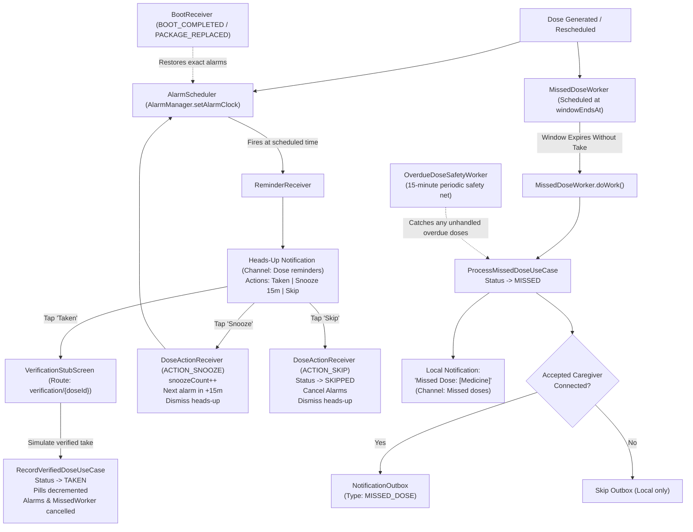

# Verification Pack: Stage 4 – Reminders & Missed-Dose Engine

> **Status: Stage 4 Implemented, Fully Tested (118/118 Passing), Awaiting User Review**

---

## Part A – Plain-Language Explanation ("How it works")

Stage 4 implements the complete scheduling, reminder heads-up, notification action handling, and missed-dose engine for MediTrack.

### 1. Exact Alarm Pipeline (`AlarmManager.setAlarmClock`)
- In Android 12+ (API 31+), background exact alarm restrictions are strict. MediTrack uses `AlarmManager.setAlarmClock(AlarmClockInfo, PendingIntent)` paired with the documented permission `SCHEDULE_EXACT_ALARM`.
- `setAlarmClock` is Android's highest-priority alarm mechanism: it bypasses Doze mode, app standby buckets, and aggressive OEM background app killers (e.g., Samsung, Xiaomi, Huawei).
- Each scheduled dose event has its exact alarm registered with a unique PendingIntent requestCode (`NotificationChannels.getNotificationIdForDose(dose.id)`).

### 2. Notification Heads-Up UI & Actions
- When the alarm triggers, `ReminderReceiver` runs and checks that the dose is still `PENDING`.
- It displays a high-priority heads-up notification in channel `"Dose reminders"` (`IMPORTANCE_HIGH`) with 3 distinct action buttons:
  1. **Taken**: Deep-links directly to `verification/{doseId}` in `MainActivity`. In debug mode, this allows the user to simulate verified intake.
  2. **Snooze 15m**: Handled asynchronously by `DoseActionReceiver`. It increments `dose.snoozeCount` (capped at `MAX_SNOOZES_PER_DOSE = 3`), verifies that the snooze target is within `windowEndsAt`, reschedules the alarm for `now + 15 min`, and dismisses the active notification.
  3. **Skip**: Handled asynchronously by `DoseActionReceiver`. It transitions the dose status to `SKIPPED` via `DoseStateMachine`, cancels any scheduled alarms and missed workers, and dismisses the active notification.

### 3. Missed-Dose Engine (`MissedDoseWorker` & `ProcessMissedDoseUseCase`)
- At the moment an intake window ends (`windowEndsAt = scheduledAt + windowMinutes`), WorkManager executes `MissedDoseWorker`.
- It dismisses any lingering heads-up notification and calls `ProcessMissedDoseUseCase(doseId)`.
- If the dose was not addressed (still `PENDING` or `UNVERIFIED`), it transitions to `MISSED`.
- **Connected Caregiver Logic**: MediTrack inspects `caregiverRepository.hasConnectedCaregiver(patientId)`. If an accepted caregiver link exists, it writes a `MISSED_DOSE` payload into Room `NotificationOutbox` for Stage 10 delivery. If no caregiver is connected, writing to the outbox is safely omitted.
- It then raises a high-priority local notification in channel `"Missed doses"` informing the patient that the window expired.

### 4. Safety Nets & Resilience
- **`OverdueDoseSafetyWorker`**: A 15-minute periodic WorkManager worker enqueued in `MediTrackApp.onCreate()`. If an exact alarm or one-time worker was delayed due to low memory or device power-off, this worker queries any overdue doses (`windowEndsAt <= now` and status `PENDING` / `UNVERIFIED`) and transitions them to `MISSED`.
- **`BootReceiver`**: Listens for `Intent.ACTION_BOOT_COMPLETED` and `Intent.ACTION_MY_PACKAGE_REPLACED`. Android clears all scheduled `AlarmManager` alarms on reboot; `BootReceiver` calls `alarmScheduler.rescheduleAllPendingAlarms()` to restore all pending dose alarms automatically.

### 5. Verification Stub (`VerificationStubScreen`)
- Route: `verification/{doseId}`.
- Summarizes medicine details, dosage, instructions, and window end time.
- **Debug builds (`BuildConfig.DEBUG`)**: Displays an informative banner explaining that CameraX blister verification arrives in Stages 5 & 6, and presents a **"Simulate Verified Intake"** button. Tapping it calls `RecordVerifiedDoseUseCase`, sets status to `TAKEN`, records `takenAt`, decrements stock, cancels alarms, and confirms intake.
- **Release builds (`!BuildConfig.DEBUG`)**: Displays "Verification not available yet".

---

## Part B – Automated Tests

Across the MediTrack project, there are now **118 automated unit test methods** across 18 test files, **all passing (100%)**:
- **Stage 0 (`AppConfigTest.kt`)**: 3 tests
- **Stage 1 Domain & Database Tests**: 50 tests
- **Stage 2 Auth & Onboarding Tests**: 28 tests
- **Stage 3 Medicine Management Tests**: 19 tests
- **Stage 4 Reminders & Missed-Dose Tests**: 18 tests (new)
  - `RecordVerifiedDoseUseCaseTest.kt`: 3 tests
  - `SnoozeDoseUseCaseTest.kt`: 3 tests
  - `SkipDoseUseCaseTest.kt`: 3 tests
  - `ProcessMissedDoseUseCaseTest.kt`: 3 tests
  - `AlarmSchedulerTest.kt`: 3 tests
  - `BootReceiverTest.kt`: 3 tests

### 1. Verification Commands & Execution Status
1. `.\gradlew.bat testDebugUnitTest` – **BUILD SUCCESSFUL in 32s** (118 tests, 0 failures, 100% passing)
2. `.\gradlew.bat lint` – **BUILD SUCCESSFUL in 46s** (0 lint errors)
3. `.\gradlew.bat assembleDebug` – **BUILD SUCCESSFUL in 28s** (Debug APK compiled cleanly)

### 2. Stage 4 Test Methods Breakdown
| Test Class | Test Method Name | Description | Result |
| :--- | :--- | :--- | :--- |
| `RecordVerifiedDoseUseCaseTest` | `recordVerifiedDose_transitionsToTaken_decrementsStock_andCancelsAlarm` | Verifies transition to TAKEN, stock decrement, and alarm cancellation | **PASSED** |
| `RecordVerifiedDoseUseCaseTest` | `recordVerifiedDose_failsWhenDoseNotFound` | Rejects non-existent dose ID | **PASSED** |
| `RecordVerifiedDoseUseCaseTest` | `recordVerifiedDose_failsWhenAlreadyTaken` | Enforces state machine rejection when dose was already taken | **PASSED** |
| `SnoozeDoseUseCaseTest` | `snoozeDose_incrementsSnoozeCount_andReturnsTriggerTime` | Snoozes pending dose and advances trigger time by 15 mins | **PASSED** |
| `SnoozeDoseUseCaseTest` | `snoozeDose_failsWhenCappedAtMaxSnoozes` | Enforces cap at `MAX_SNOOZES_PER_DOSE` (3) | **PASSED** |
| `SnoozeDoseUseCaseTest` | `snoozeDose_failsWhenTargetPastWindowEnd` | Rejects snooze if next trigger exceeds dose intake window | **PASSED** |
| `SkipDoseUseCaseTest` | `skipDose_transitionsPendingToSkipped` | Marks pending dose as SKIPPED | **PASSED** |
| `SkipDoseUseCaseTest` | `skipDose_failsWhenAlreadyMissed` | Enforces state machine rejection when dose is in terminal state | **PASSED** |
| `SkipDoseUseCaseTest` | `skipDose_failsWhenNotFound` | Rejects non-existent dose ID | **PASSED** |
| `ProcessMissedDoseUseCaseTest` | `processMissedDose_marksMissed_andEnqueuesOutboxWhenCaregiverConnected` | Transitions to MISSED and writes outbox event if caregiver connected | **PASSED** |
| `ProcessMissedDoseUseCaseTest` | `processMissedDose_marksMissed_skipsOutboxWhenNoCaregiverConnected` | Transitions to MISSED and skips outbox if no caregiver connected | **PASSED** |
| `ProcessMissedDoseUseCaseTest` | `processMissedDose_ignoresAlreadyTakenDose` | Safely ignores dose already in TAKEN status | **PASSED** |
| `AlarmSchedulerTest` | `scheduleDoseAlarm_schedulesAlarmClock` | Verifies exact AlarmClock scheduling in AlarmManager | **PASSED** |
| `AlarmSchedulerTest` | `cancelDoseAlarm_cancelsScheduledAlarm` | Verifies cancellation of scheduled alarm in AlarmManager | **PASSED** |
| `AlarmSchedulerTest` | `rescheduleAllPendingAlarms_queriesPendingAndFutureDoses` | Verifies query of pending and future doses for boot rescheduling | **PASSED** |
| `BootReceiverTest` | `processAction_bootCompleted_triggersReschedule` | Verifies full alarm reschedule on ACTION_BOOT_COMPLETED | **PASSED** |
| `BootReceiverTest` | `processAction_packageReplaced_triggersReschedule` | Verifies full alarm reschedule on ACTION_MY_PACKAGE_REPLACED | **PASSED** |
| `BootReceiverTest` | `processAction_unrelatedAction_ignores` | Ignores unrelated broadcasts | **PASSED** |

---

## Part C – Manual / Emulator Verification Runbook

Follow these quick steps to test the reminders and missed-dose engine live on your emulator:

### Step 1: Open Debug Tools Screen
1. Launch the app on your emulator and navigate to **Home**.
2. Tap the **Debug Tools** wrench icon in the top app bar.
3. Observe the new **Fast-Testing Controls (Stage 4)** section:
   - **Shorten Dose Window** toggle (switches window from 60 minutes to 1 minute).
   - **Trigger Dose Alarm Now** button (fires an alarm in ~1 second).
   - **Run Missed Dose Safety Check** button.

### Step 2: Test Immediate Dose Reminder Notification
1. In Debug Tools, tap **"Trigger Dose Alarm Now (1s)"**.
2. Within 1 to 2 seconds, pull down the Android notification shade:
   - **Notification Channel**: "Dose reminders" (High priority heads-up).
   - **Title**: "Time to take [Medicine Name]"
   - **Action Buttons**: **Taken**, **Snooze 15m**, **Skip**.

### Step 3: Test Snooze Action
1. Tap **"Snooze 15m"** on the notification.
2. Verify that the notification dismisses immediately.
3. Open Logcat and filter by `MediTrack`: observe log: `Snoozed dose ... for 15 min to ...`.

### Step 4: Test Skip Action
1. Tap **"Trigger Dose Alarm Now (1s)"** again.
2. In the notification, tap **"Skip"**.
3. Verify that the notification dismisses.
4. In Logcat, observe log: `Marked dose ... as SKIPPED`.

### Step 5: Test Verification Stub (Simulate Verified Intake)
1. Tap **"Trigger Dose Alarm Now (1s)"**.
2. Tap **"Taken"** (or tap the body of the notification).
3. The app opens to `Dose Verification (Stub)`:
   - Displays medicine name, dosage, instructions, and remaining stock.
   - Shows the Stage 4 explanation card indicating ML camera verification is coming in Stages 5 & 6.
4. Tap **"Simulate Verified Intake"**:
   - The status transitions to **TAKEN**.
   - Current stock decrements by the medicine's `pillsPerDose`.
   - The green success card appears: *"Dose Verified as TAKEN. Pill stock decremented... Alarm and missed timers cleared."*

### Step 6: Test 1-Minute Fast Window & Missed Dose Notification
1. In Debug Tools, turn **ON** the **"Shorten Dose Window"** switch (sets intake window to 1 minute).
2. Tap **"Trigger Dose Alarm Now (1s)"**.
3. Do **not** interact with the notification. Wait 65 seconds for the 1-minute window to expire.
4. WorkManager triggers `MissedDoseWorker`:
   - The reminder notification is dismissed.
   - A new high-priority notification appears: **"Missed Dose: [Medicine Name] - The intake window has passed without verified intake."**
   - In Logcat, observe `ProcessMissedDoseUseCase` marking the dose as `MISSED`.
