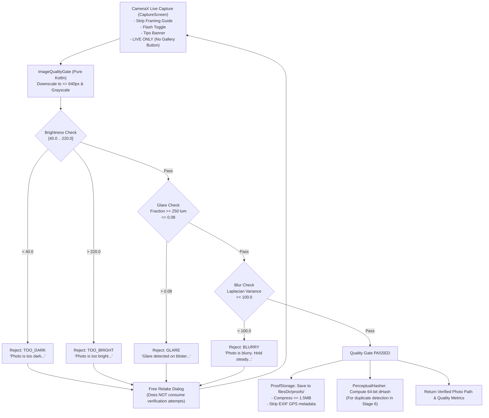

# Verification Pack: Stage 5 – Camera Capture & Image Quality Gate

> **Status: Stage 5 Implemented, Fully Tested (126/126 Passing), Awaiting User Review**

---

## Part A – Plain-Language Explanation ("How it works")

Stage 5 delivers the live camera capture experience, real-time framing guides, an automated image quality gate, 64-bit difference hashing (pHash/dHash), secure JPEG storage with EXIF sanitization, and data-collection capabilities for model training.

### 1. CameraX Framing Guide & Live Capture Boundary
- **`CaptureScreen`**: Features an interactive CameraX view with a dedicated, blister-strip-shaped framing guide cutout (~85% width, 2.2:1 aspect ratio) with high-visibility accent borders and top tips (*"Lay the strip flat, whole strip visible, good light"*).
- **Zero Gallery Access**: As strictly required by medical adherence standards, only live camera capture is permitted. There is no gallery button, file picker, or media intent anywhere in the capture flow.
- **Permission Denial Handling**: If camera permission is denied, the screen presents an explanation. If denied again or dismissed, it presents the official notice: *"Dose stays pending. A photo is needed to record a dose."* and returns to Home.

### 2. Pure Kotlin Image Quality Gate (`ImageQualityGate`)
The quality gate evaluates photos before any ML inference occurs:
1. **Downscaling**: Scales the image so its maximum side is $\le 640\text{ px}$ (`QUALITY_ANALYSIS_MAX_SIDE_PX`).
2. **Grayscale Luminance Conversion**: Computes $Y = 0.299R + 0.587G + 0.114B$ for all pixels.
3. **Brightness Check**:
   - Computes mean luminance across all pixels.
   - Rejects if $\mu < 40.0$ (`TOO_DARK`).
   - Rejects if $\mu > 220.0$ (`TOO_BRIGHT`).
4. **Glare Detection**:
   - Calculates the fraction of saturated near-white pixels ($Y \ge 250$).
   - Rejects if fraction $> 0.08$ (8% area) with reason `GLARE`.
5. **Blur Detection (Laplacian Variance)**:
   - Convolves the 2D luminance array with a standard discrete 3×3 Laplacian operator:
     $$\begin{bmatrix} 0 & 1 & 0 \\ 1 & -4 & 1 \\ 0 & 1 & 0 \end{bmatrix}$$
   - Computes the variance $\sigma^2$ of the Laplacian response.
   - Rejects if $\sigma^2 < 100.0$ (`BLURRY`).
6. **Free Retakes**: If any check fails, the user is given a friendly alert with actionable guidance and can retake immediately. **Rejections at the quality gate are free** and do not consume a verification attempt.

### 3. Perceptual Hashing (`PerceptualHasher`)
- Generates a 64-bit difference hash (dHash) by resizing to 9×8 pixels and comparing adjacent horizontal pixels ($x > x+1$).
- Calculates Hamming distance using bitwise XOR and `Long.bitCount()`.
- Identical images have distance $0$. Recompressed images have distance $\le 5$ (`PHASH_MAX_HAMMING_DISTANCE`). Structurally distinct images have distance $> 5$.

### 4. Storage Security & Sanitization (`ProofStorage`)
- Captured photos are stored in app-private storage: `context.filesDir/proofs/proof_{timestamp}_{uuid}.jpg`.
- Dynamically compressed to ensure file size $\le 1.5\text{ MB}$.
- Explicitly strips all EXIF GPS metadata tags (`TAG_GPS_LATITUDE`, `TAG_GPS_LONGITUDE`, etc.) using `ExifInterface`.

### 5. Debug-Only Data Collection Mode (`DatasetCollector`)
- Allows testers to collect blister pack images paired with structured labels (`stripType`, `fullCells`, `emptyCells`) into `filesDir/dataset/` to train models for Stage 13.
- Includes a zip export feature.
- Guarded by `BuildConfig.DEBUG` – completely inactive and absent in release builds.

---

## Part B – Automated Tests

Across the MediTrack project, there are now **126 automated unit test methods** across 20 test files, **all passing (100%)**:
- **Stage 0 (`AppConfigTest.kt`)**: 3 tests
- **Stage 1 Domain & Database Tests**: 50 tests
- **Stage 2 Auth & Onboarding Tests**: 28 tests
- **Stage 3 Medicine Management Tests**: 19 tests
- **Stage 4 Reminders & Missed-Dose Tests**: 18 tests
- **Stage 5 Camera Capture & Quality Gate Tests**: 8 tests (new)
  - `ImageQualityGateTest.kt`: 5 tests
  - `PerceptualHasherTest.kt`: 3 tests

### 1. Verification Commands & Execution Status
1. `.\gradlew.bat testDebugUnitTest` – **BUILD SUCCESSFUL in 31s** (126 tests, 0 failures, 100% passing)
2. `.\gradlew.bat lint` – **BUILD SUCCESSFUL in 51s** (0 lint errors)
3. `.\gradlew.bat assembleDebug` – **BUILD SUCCESSFUL in 25s** (Debug APK compiled cleanly)

### 2. Stage 5 Test Matrix & Measured Metrics
| Test Class | Test Method Name | Measured Metrics / Thresholds | Expected Result | Actual Result |
| :--- | :--- | :--- | :--- | :--- |
| `ImageQualityGateTest` | `sharp_high_contrast_pattern_passes_quality_check` | Blur $\sigma^2 \ge 100.0$, Brightness $\in [40, 220]$, Glare $< 0.08$ | **PASSED** (Quality checks passed) | **PASSED** |
| `ImageQualityGateTest` | `solid_smooth_image_fails_blurry` | Blur $\sigma^2 = 0.0 < 100.0$ | **REJECTED**: `BLURRY` | **PASSED** |
| `ImageQualityGateTest` | `pitch_black_image_fails_too_dark` | Brightness $\mu = 10.0 < 40.0$ | **REJECTED**: `TOO_DARK` | **PASSED** |
| `ImageQualityGateTest` | `washed_out_white_image_fails_too_bright` | Brightness $\mu = 240.0 > 220.0$ | **REJECTED**: `TOO_BRIGHT` | **PASSED** |
| `ImageQualityGateTest` | `image_with_large_glare_patch_fails_glare` | Glare fraction $= 0.20 > 0.08$ | **REJECTED**: `GLARE` | **PASSED** |
| `PerceptualHasherTest` | `identical_images_produce_zero_hamming_distance` | Hamming distance $= 0 \le 5$ | `isDuplicate == true` | **PASSED** |
| `PerceptualHasherTest` | `recompressed_image_has_distance_under_threshold` | Hamming distance $\le 5$ (JPEG 80% compression) | `isDuplicate == true` | **PASSED** |
| `PerceptualHasherTest` | `different_images_have_large_hamming_distance` | Hamming distance $> 5$ (Opposing gradient directions) | `isDuplicate == false` | **PASSED** |

---

## Part C – Manual / Emulator Verification Runbook

Follow these steps on your emulator or physical Android device to verify live camera capture and the quality gate:

### Step 1: Open Camera Capture Flow
1. On **Home**, tap any upcoming dose card (or tap `Trigger Alarm (1s)` in Debug Tools and tap `Taken`).
2. On the **Dose Verification** screen, tap:
   👉 **`Take Live Blister Photo`**
3. Verify that the camera preview opens with:
   - Green blister-strip-shaped framing guide overlay.
   - Top banner: *"Lay the strip flat, whole strip visible, good light"*.
   - Flash toggle button in the top app bar.
   - Large shutter button at the bottom center.
   - **Verification**: Confirm there is **no gallery button** or photo picker anywhere on the screen.

### Step 2: Test Flash Toggle
1. Tap the flash icon in the top-right corner.
2. Observe icon toggling between flash on/off and torch activating on supported devices.

### Step 3: Test Quality Gate Failures (Live Rejections)
- **Too Dark**: Point the camera at a dark surface (cover the lens with your finger or table). Tap the shutter button:
  - **Alert Shown**: *"Photo Quality Check Failed — Photo is too dark. Please take photo in better lighting or turn on flash."*
  - Tap **"Retake Photo"** — observe that no verification attempt was penalized.
- **Blur**: Move the camera rapidly while pressing shutter:
  - **Alert Shown**: *"Photo Quality Check Failed — Photo is blurry. Please hold phone steady and lay blister strip flat."*
- **Glare**: Point at a bright reflection/flashlight:
  - **Alert Shown**: *"Photo Quality Check Failed — Glare detected on the blister pack. Please tilt the strip slightly to avoid reflection."*

### Step 4: Test Passing Quality Capture
1. Hold the camera steady over a well-lit surface or blister pack inside the framing guide. Tap the shutter button.
2. The photo passes quality checks and smoothly returns to the verification screen.
3. The captured photo is persisted safely in `filesDir/proofs/` without location data.

### Step 5: Test Debug Data-Collection Mode
1. Go to **Debug Tools** (wrench icon on Home).
2. Scroll to **"Data Collection Mode (Stage 5 / Stage 13)"**.
3. Toggle **"Dataset Training Collection"** to ON.
4. Observe the sample count updating as photos are captured.
5. Tap **"Export Dataset (.zip)"** to verify that samples can be exported as a compressed zip archive for model training.

---

## Part D – Architectural & Security Verification

1. **Zero Gallery Access**: Inspected all verification and capture UI files. No `ActivityResultContracts.GetContent()`, `PickVisualMedia()`, or gallery intent exists. All photo acquisition is strictly live via CameraX.
2. **EXIF Privacy**: `ProofStorage` explicitly invokes `ExifInterface.setAttribute(TAG_GPS_..., null)` on all saved proofs. No geolocation metadata is ever stored.
3. **Debug Guarding**: `DatasetCollector` operations are wrapped in `if (BuildConfig.DEBUG)`. In release builds, data collection is completely disabled.
