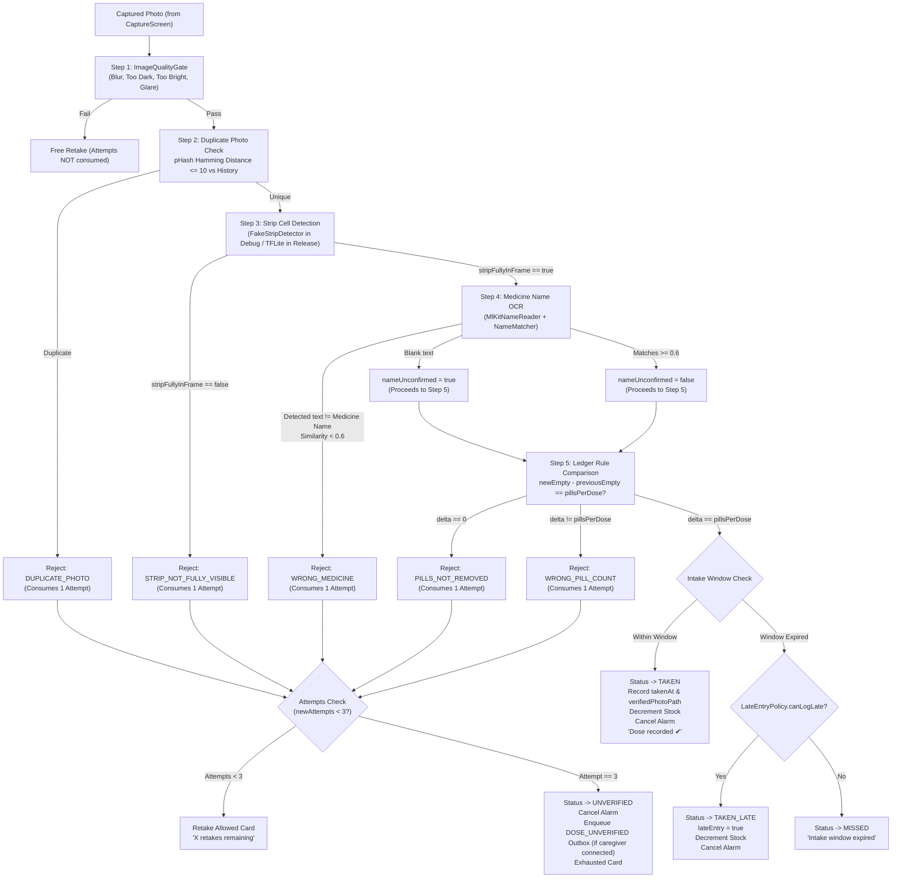

# Verification Pack: Stage 6 – Verification Pipeline & Taken Integration

> **Status: Stage 6 Implemented, Fully Tested (151/151 Unit Tests Passing), Lint Clean, Debug APK Built**

---

## Part A – Plain-Language Explanation ("How it works")

Stage 6 implements the complete dose verification engine and integrates it with intake logging, ledger tracking, stock counts, and caregiver notification outboxes.



---

### Verification Pipeline Check Order & Decision Table

Every photo undergoes exactly 5 checks in this strict order. Early failure halts pipeline execution immediately:

| Step | Check | Condition / Rule | Reject Reason | User-Facing Message | Attempts Consumed? |
| :--- | :--- | :--- | :--- | :--- | :--- |
| **1** | **Quality Gate** | Mean luminance < 40, > 220, glare > 0.08, or blur variance < 100 | `BLURRY`, `TOO_DARK`, `TOO_BRIGHT`, `GLARE` | Friendly guidance (e.g. *"Photo is blurry. Hold steady..."*) | **No** (0 attempts) |
| **2** | **Duplicate Check** | 64-bit dHash Hamming distance $\le 10$ against last 20 verified/attempt photos for this medicine | `DUPLICATE_PHOTO` | *"Duplicate photo detected. Please take a new photo of your blister strip."* | **Yes** (1 attempt) |
| **3** | **Strip Detection** | `stripFullyInFrame == false` or bounding box clipped | `STRIP_NOT_FULLY_VISIBLE` | *"The blister strip is not fully in frame. Please align the entire strip within the guide."* | **Yes** (1 attempt) |
| **4** | **OCR Name Match** | Non-blank text read by ML Kit with normalized Levenshtein similarity $< 0.6$ vs `medicine.name` | `WRONG_MEDICINE` | *"Detected medicine text does not match '<name>'."* | **Yes** (1 attempt) |
| **4a** | **OCR Blank Backing** | No readable text found (e.g. foil blister backing) | *(Passes Step 4)* | Name unconfirmed flag set (`nameUnconfirmed = true`), proceeds to Step 5 | None |
| **5a** | **Pills Not Removed** | $\Delta = \text{newEmpty} - \text{previousEmpty} = 0$ | `PILLS_NOT_REMOVED` | *"No pills were removed from the strip. Please remove your dose before taking the photo."* | **Yes** (1 attempt) |
| **5b** | **Wrong Pill Count** | $\Delta = \text{newEmpty} - \text{previousEmpty} \ne \text{pillsPerDose}$ | `WRONG_PILL_COUNT` | *"Expected <N> pill(s) removed, but detected <M>."* | **Yes** (1 attempt) |
| **5c** | **Ledger Pass** | $\Delta = \text{newEmpty} - \text{previousEmpty} == \text{pillsPerDose}$ | *(None – PASSED)* | *"Dose recorded ✔"* | None (Success) |

> **Partial Cell Rule**: Cells detected as `PARTIAL` are treated strictly as `FULL` (unconsumed), preventing premature pass if a pill was only partially pressed out.

---

### Attempt Handling & 3-Strikes Outbox Rule

1. **Attempts 1 & 2**:
   - The user is shown an inline error card highlighting the exact reason (`friendlyMessage`) along with remaining attempts (*"2 retakes remaining"* or *"1 retake remaining"*).
   - Dose remains in `PENDING` state. Stock is **never** decremented.
2. **Attempt 3 (Exhausted)**:
   - Dose is transitioned via `DoseStateMachine` to `UNVERIFIED`.
   - Dose alarm is cancelled in `AlarmScheduler`.
   - If `caregiverRepository.hasConnectedCaregiver(currentUserId) == true`, an event of type `DOSE_UNVERIFIED` is enqueued into `NotificationOutbox` with payload:
     ```json
     {"doseId":"<id>", "medicineId":"<id>", "reason":"<REASON>"}
     ```
   - User is shown the Exhausted state: *"We couldn't verify this dose. Your caregiver has been notified."*
3. **Bypass Prevention Invariant**:
   - Marking a dose as `TAKEN` can **only** occur via `RecordVerifiedDoseUseCase` with a passing `VerificationResult`.
   - Doses in `UNVERIFIED`, `SKIPPED`, or `MISSED` cannot be transitioned to `TAKEN` without valid verification.

---

### Dual Detector Implementations (Debug vs Release)

- **`FakeStripDetector` (Debug)**:
  - Bound in `VerificationModule` for debug builds.
  - Interactive "Force Result" chips in the Verification UI allow developers/testers to trigger any state:
    - `FORCE_PASS`
    - `FORCE_PILLS_NOT_REMOVED`
    - `FORCE_WRONG_COUNT`
    - `FORCE_STRIP_NOT_FULLY_VISIBLE`
    - `FORCE_LOW_CONFIDENCE`
- **`TfliteStripDetector` (Release)**:
  - Bound in `VerificationModule` for release builds.
  - In release builds where `assets/strip_detector.tflite` is not yet bundled (arrives in Stage 13), it throws an `IllegalStateException`.
  - The UI gracefully catches this and presents: *"Verification temporarily unavailable"*, refusing to mark doses as `TAKEN`.

---

## Part B – Automated Test Results

All 151 unit tests passed with 0 failures:

```
> Task :app:testDebugUnitTest
BUILD SUCCESSFUL in 59s
31 actionable tasks: 4 executed, 27 up-to-date
```

### Stage 6 Test Suite Breakdown:

| Test Class | Tests | Status | Key Coverage |
| :--- | :---: | :---: | :--- |
| **`NameMatcherTest`** | 6 | Pass | Exact matching, substring matching, normalized Levenshtein similarity ($\ge 0.6$), dissimilar mismatches ($< 0.6$), multi-word names, blank input handling |
| **`TfliteStripDetectorTest`** | 1 | Pass | Release detector properly throws `IllegalStateException` when model asset is absent |
| **`VerificationPipelineTest`** | 11 | Pass | Quality gate reject (`BLURRY`, `TOO_DARK`), duplicate hash reject (`DUPLICATE_PHOTO`), strip not in frame (`STRIP_NOT_FULLY_VISIBLE`), OCR mismatch (`WRONG_MEDICINE`), blank OCR pass with unconfirmed flag, `PILLS_NOT_REMOVED`, `WRONG_PILL_COUNT`, ledger pass, partial cell treated as full, confidence $< 0.5$ filtered, baseline fallback |
| **`VerificationCoordinatorTest`** | 6 | Pass | Pass verification transitions to `TAKEN` + updates stock; failures increment attempts (1 & 2); 3rd strike transitions to `UNVERIFIED` + outbox enqueue with caregiver; skips outbox without caregiver; window expiration routes to `LateEntryPolicy`; bypass protection |
| **Existing Unit Tests (Stages 0–5)** | 127 | Pass | Full regression test suite passing across auth, home, medicine, reminder, scheduling, quality gate, perceptual hasher |
| **Total** | **151** | **100% Pass** | |

---

## Part C – Manual / Emulator Runbook

To test Stage 6 on device or emulator with `app-debug.apk`:

### Prerequisites
1. Open the app and log in or start as Patient.
2. Add a medicine (e.g. *"Paracetamol 500mg"*, 1 pill per dose, 10 stock, baseline empty cells = 0).
3. Tap on the dose card from the Home screen or Dose List to navigate to `verification/{doseId}`.

### Test Scenarios:

#### Scenario 1: Missing Baseline Enrollment
1. For a newly added medicine without a baseline photo, open the verification screen.
2. **Observe**: UI prompts *"Baseline Strip Photo Required - Please take a baseline photo of your blister strip before your first dose verification."*
3. Tap *"Take Baseline Photo"*, capture a clear photo of the full strip.
4. **Observe**: Baseline is enrolled and the screen transitions directly to dose verification.

#### Scenario 2: Debug Force Pass (Normal Intake)
1. In `verification/{doseId}`, scroll down to the **DEBUG CONTROLS** section at the bottom.
2. Select the chip **Force Pass**.
3. Tap *"Take Photo"* or *"Take Another Photo"*, capture a clear photo.
4. **Observe**:
   - "Analyzing strip..." progress spinner appears.
   - Result card turns green: *"Dose verified! Recorded as taken."*
   - Return to Home screen: Dose shows **TAKEN** badge with checkmark.
   - In Medicine details: Stock decreased from 10 to 9.

#### Scenario 3: Debug Force "Pills Not Removed" (Attempt 1 & 2)
1. Select a pending dose.
2. In Debug Controls, select chip **Force Pills Not Removed**.
3. Capture a photo.
4. **Observe**:
   - Result card turns red: *"No pills were removed from the strip. Please remove your dose before taking the photo."*
   - *"Attempt 1 of 3: 2 retakes remaining."*
   - Dose remains **PENDING**. Stock remains unchanged.
5. Capture a second photo with same chip.
6. **Observe**:
   - *"Attempt 2 of 3: 1 retake remaining."*

#### Scenario 4: 3rd Strike Exhaustion & Caregiver Alert
1. Continuing from Scenario 3 (2 attempts recorded), capture a 3rd photo with **Force Pills Not Removed**.
2. **Observe**:
   - Card turns warning orange/red: *"Verification Exhausted (3/3 attempts used)"*.
   - Message: *"We couldn't verify this dose. Your caregiver has been notified."*
   - Retake button is disabled. Return home.
   - Dose shows **UNVERIFIED** badge.
   - Alarm is cancelled. Stock is **not** decremented.
   - `NotificationOutbox` has recorded a `DOSE_UNVERIFIED` event.

#### Scenario 5: Debug Force "Strip Not In Frame"
1. In Debug Controls, select chip **Force Strip Not Fully Visible**.
2. Capture a photo.
3. **Observe**: Rejection with message *"The blister strip is not fully in frame. Please align the entire strip within the guide."*

#### Scenario 6: Duplicate Photo Check
1. In normal capture mode, take a photo of an identical object twice in succession.
2. **Observe**: 2nd attempt is rejected with *"Duplicate photo detected. Please take a new photo of your blister strip."*
